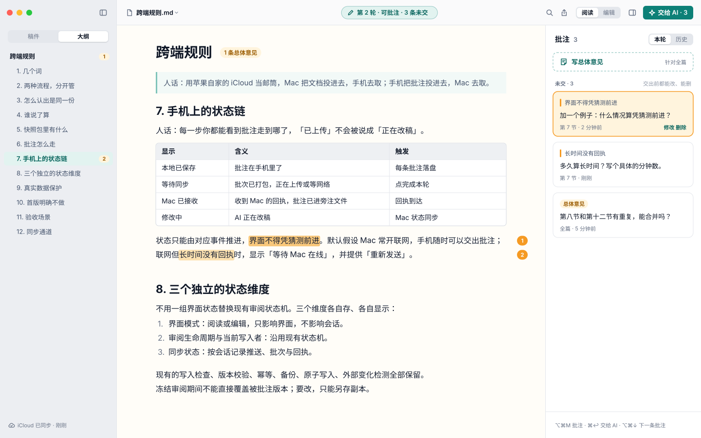
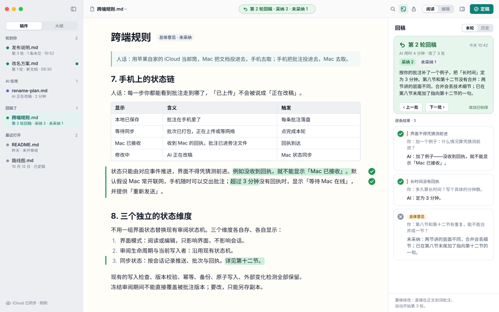
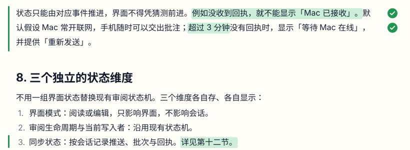
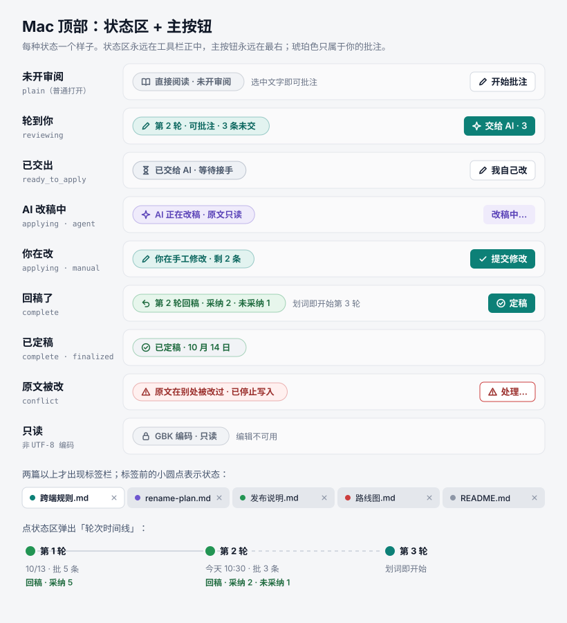
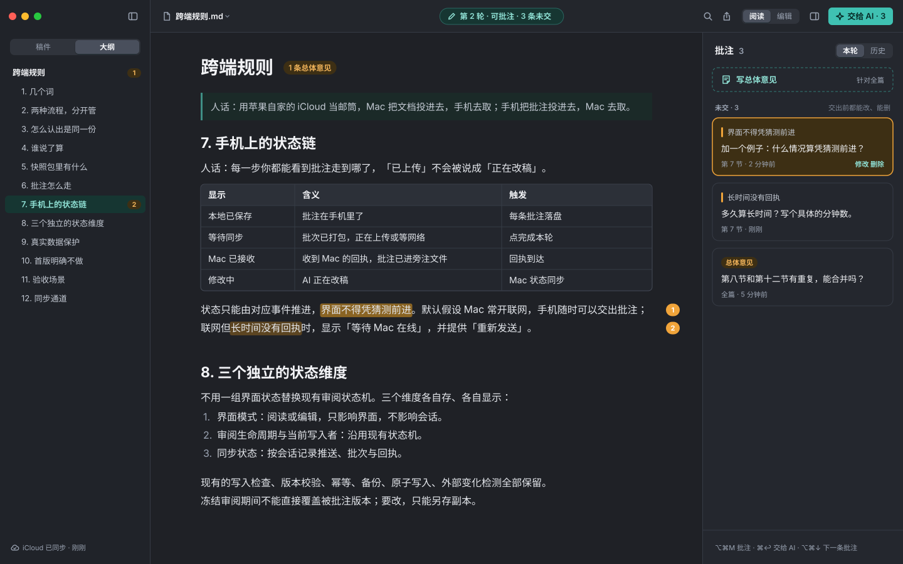
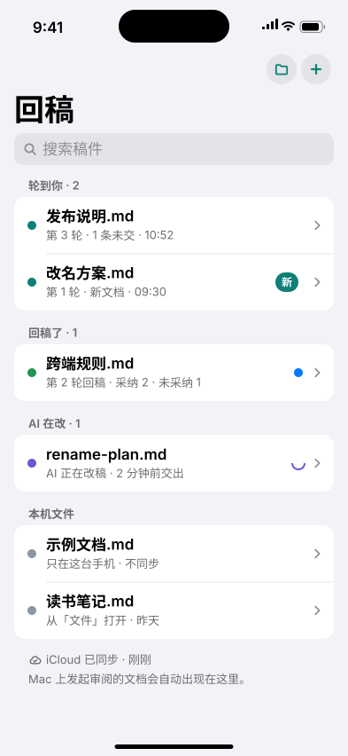
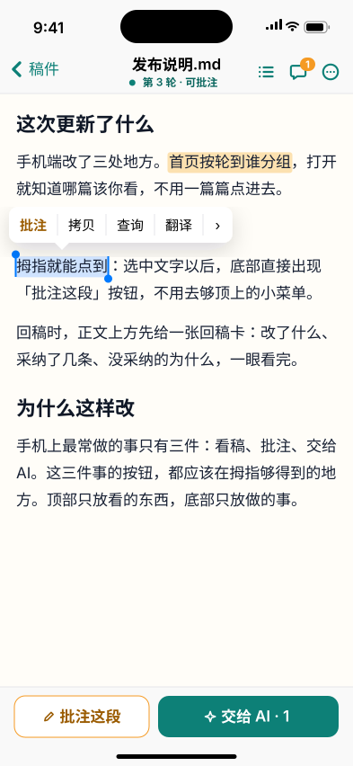
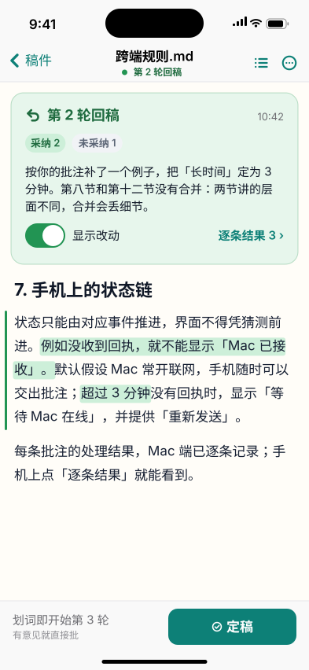
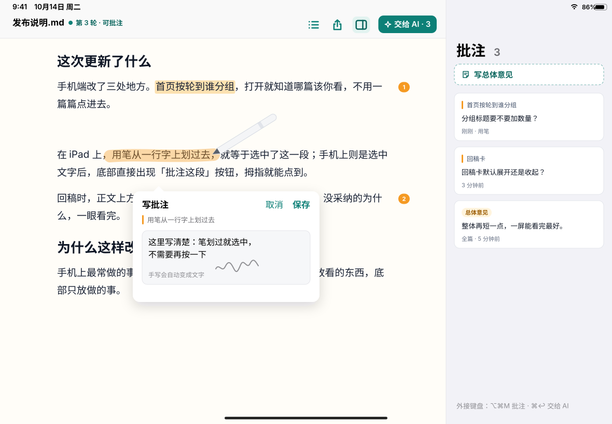

# 回稿 UI 方案:Mac 与 iPhone(2026-10-14)

> **v2 修订(2026-10-14 深夜)**:第 1~3、6 节按两份已拍板文档——[电脑版规划 v3](mac-status-and-plan.md)、[轮次版本记录设计 v4](version-record-design.md)——对齐,经 Codex 只读审查。要点:① 对比在**独立只读对比视图**里看(含新增、删除、替换),不在批注用的正文里画删除线;② 回稿卡的摘要、计数、逐条结果取自版本事件的归档记录,不再说"数据已有、不需要后端";③ 已交出分三档(没有 AI 接入 / ○○ 在线等待领取 / AI 正在修改),没人接入时主按钮「复制改稿指令」;④ 开轮只在**首次成功保存**一条批注或总体意见时;⑤ 恢复是版本事件(无活动会话、无编辑登记才可;恢复前当前稿留底;产生新轮次与身份;只恢复正文);⑥ 交出后计数与处理门槛只看固定的本轮成员;⑦ 状态表补恢复、作废、零批注通过、独立手工修改;⑧ 另存副本是新身份;⑨ 3.7 实施表改为已完成 / 待补 / 依赖清单;⑩ 第 6 节 13 问里电脑端已无需拍板,颜色、图标、版心按推荐默认值先做、装机后再调。第 4 节 iPhone 与手机问题暂缓,电脑端完成后再议;冲突时以两份已拍板文档为准。


三个终端我按 **Mac、iPhone、iPad** 理解;你已决定 iPad 以后再做,所以这篇把 Mac 和 iPhone 做扎实,iPad 只留一页「以后怎么做」(第 5 节)。如果第三端你指的是别的(Windows、网页),在这句上批注。

怎么读:第 0 节一屏读完结论;第 1 节先定功能边界(对照 Typora,定要什么、不要什么);第 2 节是共用的设计语言;第 3、4 节分端画界面;第 5 节是 iPad 的一页;第 6 节是需要你拍板的问题,每条带了我的推荐。图都在 `docs/ui-proposals/` 里,在回稿里打开这篇就能看到;整窗图字小,每张后面配了局部放大。

---

## 0. 结论先行

**定位一句话**:你批一轮、AI 改一轮、稿子自己回来。不用 AI 的时候,它也是一个安静、好用的 Markdown 阅读编辑器。

| 终端 | 角色 | 核心主张 |
|---|---|---|
| Mac | 改稿工作台 | AI 在这台电脑上改稿;你在这里批注、看改动、精修、定稿。顶部正中一个状态区告诉你稿子此刻在谁手里。 |
| iPhone | 随身收稿 | 首页按「轮到谁」排好;读稿时拇指区一边是「批注这段」,一边是「交给 AI」;稿子回来时正文上方一张回稿卡。 |
| iPad(以后) | 书桌上的稿纸 | 沿用 iPhone 的全部逻辑,加分栏、用笔批注、页边批注。见第 5 节。 |

两端统一的五个决定(iPad 以后沿用):

1. **同一套「轮到谁」状态**:轮到你、已交出、AI 在改、回稿了、已定稿,外加冲突和只读两种例外。名字、颜色、图标两端一样。
2. **一屏只有一个主按钮,永远在同一个位置**:Mac 在工具栏最右,iPhone 在底栏右侧。
3. **颜色只表示状态**:琥珀只属于你的批注;AI 正在做的事用紫色;等待用灰蓝;稿子回来用绿色;冲突用红色。
4. **稿子回来是一个专门设计的时刻**:回稿卡说清改了什么、采纳几条、没采纳的为什么;正文里的改动标绿;一键跳到下一处改动。
5. **少而精**:常驻界面只放闭环动作和最常用的几件事;其余放进菜单、快捷键和 Markdown 语法里,想找能找到,平时不打扰。

---

## 1. 功能边界:对照 Typora 定要什么、不要什么

### 1.1 结论:同意「少而精」;「巧妙的架构」是三层加三条规矩

同意,理由有三:

- **用的人用不到那么多**。Typora 的菜单顶层有 124 行(不算子菜单),你说大半没打开过,这是常态。功能多的代价不是菜单长,而是每多一个功能,就多一份要学的东西、多一种出错的方式、手机上多一处对不齐。
- **我们赢在闭环,基本盘只要「不输」**。「好用的 Markdown 编辑器」这件事 Typora、Obsidian、Bear 已经做到头了,我们在这上面堆功能赢不了;但阅读和编辑的手感必须一点不输,否则没人留下来体验闭环。
- **做重会变四不像**。四种东西明确不做:笔记库(文件树、标签、双向链接)、代码编辑器(源码模式、按行操作)、排版发布工具(主题市场、十几种导出)、网盘(把整个文件夹同步到手机)。

「巧妙的架构」不是把功能藏起来,而是**让每个功能只在该出现的时候出现**。分三层:

| 层 | 放什么 | 回稿里的样子 |
|---|---|---|
| 常驻层(永远看得见,不超过 6 样) | 闭环动作和最常用的几件事 | Mac 工具栏:状态区、主按钮、阅读/编辑、批注栏开关、查找、导出。手机底栏:主按钮和「批注这段」 |
| 情境层(该出现时才出现) | 只在某个时刻有意义的东西 | 选中文字才出现「批注」;进编辑模式才出现格式条和 / 插入菜单;稿子回来才出现回稿卡和「显示改动」;冲突才出现「处理」;编码只读才出现锁 |
| 完整层(想找能找到,不打扰) | 所有动作的完整清单 | Mac 菜单栏按苹果习惯排;熟手用快捷键;写的时候直接打 Markdown 语法(打 `# ` 就是标题),界面成本为零;iPhone 收在「…」菜单 |

三条规矩:

1. **默认就对,少给选项**。一套精心调好的阅读样式;浅色、深色跟系统;字号能缩放;草稿自动暂存。不做主题市场,不做「偏好设置」大全。默认值清单见 1.5。
2. **每加一个功能先过两问**:它服务闭环吗?它服务「好用的阅读编辑」基本盘吗?两个都不是,就不做。1.6 用六个曾经想做的功能示范这两问。
3. **一个动作只有一个家**。界面上每个动作只出现在一个地方;菜单和快捷键是备用入口,不在界面上重复摆第二个按钮。

怎么检验有没有做重,两个能数的指标:**常驻层控件不超过 6 个**;**新用户从打开文档到交出第一条批注不超过 4 步**(打开、划词、写、交给 AI)。现在的 Mac 版是 5 步(中间多一步「开始审阅」),方案里减掉。

### 1.2 Typora 菜单逐项对照

标记:**已有**(现在就能用)、**要补**(第一批或第二批要做)、**以后**(有价值但不急)、**不做**(有理由地不做)、**系统**(macOS 自带,不用我们做)。

按行数统计:已有 32 行,要补 10 行,以后 12 行,不做 24 行,系统 3 行。

**App 菜单**

| Typora | 回稿 | 理由 |
|---|---|---|
| 关于 | 已有 | |
| 我的许可证 | 不做 | 不单独做许可证体系,怎么收费另议 |
| 设置… ⌘, | 要补 | 极简设置窗口,规格见 1.5 |
| 检查更新 | 以后 | 走 App Store 或 TestFlight 更新就不需要;坚持官网下载版再加 |
| 服务、隐藏 ⌘H、隐藏其他 ⌥⌘H、全部显示、退出 ⌘Q | 已有 | 系统标准 |

**文件**

| Typora | 回稿 | 理由 |
|---|---|---|
| 新建 ⌘N | 已有 | |
| 新建标签页 ⌘T | 不做 | 一个标签就是一篇文档,⌘N 和 ⌘O 本来就开新标签,空白标签没有意义 |
| 新建窗口 ⇧⌘N | 以后 | 单窗口多标签够用;多窗口会让「哪个窗口在审哪篇」变复杂 |
| 打开… ⌘O | 已有 | |
| 打开最近文件 > | 要补 | 苹果标准子菜单,成本很低;现在只在左栏和欢迎页 |
| 快速打开… ⇧⌘O | 要补(第二批) | 只搜稿件和最近文件,键盘一秒切换,界面零成本 |
| 显示简介… | 不做 | 访达里有 |
| 在文档列表中显示、在文件树中显示 | 不做 | 不做文件树 |
| 打开文件位置 | 要补 | 改叫「在访达中显示」,常用,一行代码 |
| 删除… | 不做 | 删文件交给访达;正在审阅的文件被删,会话就失联了 |
| 关闭 ⌘W | 已有 | |
| 保存… ⌘S | 已有 | 只在编辑时有意义,阅读时置灰 |
| 复制 ⇧⌘S | 要补 | 改叫「另存为副本」:审阅中原文锁定,想自己动手改就另存一份;**副本是新文档身份,不继承原稿历史** |
| 重新命名…、移到… | 不做(访达里做) | 回稿里打开时发现文档被改名或移动,提示一次「受控重关联」保留身份与历史(版本记录设计 v4 第 2 节);不把「旁注对不上」当最终处理 |
| 复原到 > | 要补(回稿版) | 换成「恢复到第 N 轮改稿前」:是版本事件,条件与做法见版本记录设计 v4 第 6 节(无活动会话、无编辑登记才可;恢复前当前稿留底;产生新轮次与新身份;只恢复正文,附件变化另提示) |
| 从磁盘重新加载 | 已有 | 自动:文件在外面被改,回稿会重新载入或提示,不需要菜单 |
| 保存全部打开的文件 ⌥⌘S | 不做 | 一次只编辑一篇,草稿自动暂存 |
| 共享 > | 以后 | 「发给别人」现在靠导出 PDF、HTML 已经能做 |
| 导入… | 不做 | 回稿只读写 Markdown,把 Word 转成 Markdown 不是核心 |
| 导出 > | 已有 | PDF、HTML、Word。Word 依赖电脑上装有 pandoc,上架前要解决 |
| 页面设置… ⇧⌘P | 不做 | 打印对话框里已有 |
| 打印… ⌘P | 已有 | |

**编辑**

| Typora | 回稿 | 理由 |
|---|---|---|
| 撤销、重做 | 已有 | 编辑模式下;阅读时撤销刚写的批注以后再说 |
| 剪切、拷贝、粘贴 | 已有 | |
| 拷贝图片 | 系统 | 右键菜单自带 |
| 复制为纯文本、复制为 Markdown ⇧⌘C、复制为 HTML 代码、复制内容并简化格式 | 以后 | 「拷贝为 Markdown」对「把一段话贴给 AI」有用,第二批考虑;其余三个不做 |
| 粘贴为纯文本 ⇧⌘V | 要补 | 用苹果现成的「粘贴并匹配样式 ⌥⇧⌘V」,从网页粘贴时不带乱格式 |
| 选择 > | 已有 | 全选 ⌘A;其余用系统手势 |
| 上移该行 ⌥↑、下移该行 ⌥↓ | 不做 | 编辑器左侧有段落把手,拖动就能调顺序 |
| 删除、删除范围 > | 不做 | |
| 数学工具 > | 以后 | 阅读时公式已能正确显示;编辑公式现在按原文编辑 |
| 换行符 >、空格与换行 > | 不做 | 回稿保存时只改你改过的行,原文件的换行风格原样保留,不需要用户操心 |
| 替换 > | 要补 | 编辑模式的查找替换(路线图第四轮) |
| 拼写和语法检查 > | 系统 | |
| 查找 > | 已有 | 阅读模式已有;编辑模式随「替换」一起补 |
| 语音 >、自动填充 >、开始听写…、表情与符号 | 系统 | macOS 自动加进编辑菜单 |

**段落**

| Typora | 回稿 | 理由 |
|---|---|---|
| 一级~六级标题 ⌘1~⌘6、段落 ⌘0 | 已有(快捷键不同) | 写的时候打 `# ` 就是标题;快捷键用编辑器自带的 ⌥⌘1~⌥⌘6、⌥⌘0。⌘0 在回稿里是「实际大小」,不抢 |
| 提升/降低标题级别 ⌘+ ⌘- | 不做 | 和缩放快捷键冲突;直接设级别更快 |
| 表格 > | 已有 | 打 / 插入表格,表格里能加删行列 |
| 公式块 ⌥⌘B | 以后 | 同数学工具 |
| 代码块 ⌥⌘C、代码工具 > | 已有 | 打 ``` 或 / 插入,能选语言 |
| 警告框 > | 以后 | GitHub 风格的提示框,先保证阅读时能正确显示 |
| 引用 ⌥⌘Q | 已有 | 打 `> ` 或 / 插入 |
| 有序列表 ⌥⌘O、无序列表 ⌥⌘U、任务列表 ⌥⌘X | 已有 | 打 `1. ` `- ` `- [ ] `。任务列表在阅读模式下现在显示成文字「[ ]」,要补成只读勾选框 |
| 任务状态 > | 已有 | 编辑模式下点勾选框 |
| 列表缩进 > | 已有 | Tab、⇧Tab |
| 在上方插入段落、在下方插入段落 | 不做 | 段落把手加回车就够 |
| 链接引用 ⌥⌘L、脚注 ⌥⌘R | 以后 | 保存时原样保留;阅读时显示脚注以后再做 |
| 水平分割线 ⌥⌘- | 已有 | 打 `---` 或 / 插入 |
| 内容目录 | 不做 | 左栏大纲就是目录 |
| YAML Front Matter | 已有 | 阅读时隐藏,编辑和保存时原样保留 |

**格式**

| Typora | 回稿 | 理由 |
|---|---|---|
| 加粗 ⌘B、斜体 ⌘I | 已有 | 编辑模式;选中文字会浮出格式条 |
| 下划线 ⌘U | 不做 | Markdown 没有下划线,只能写成 HTML 标签,弄脏原文 |
| 代码 ⌃` | 已有 | 浮出格式条或打反引号 |
| 内联公式 ⌃M | 以后 | |
| 删除线 ⌃⇧` | 已有 | 浮出格式条或打 `~~` |
| 注释 ⌃- | 不做 | 回稿用「批注」代替往正文里写注释,批注不弄脏原文 |
| 超链接 ⌘K | 已有,补快捷键 | 浮出格式条里有,补上 ⌘K |
| 链接操作 > | 已有 | 链接悬浮条能改、能复制 |
| 图像 > | 要补(第二批) | 粘贴或拖入图片时,存到文档旁的 `images/` 文件夹并写相对路径。现在插入图片走的是编辑器默认设置,只存成临时地址,重开文档很可能就丢了(要先验证),这是个真问题 |
| 从 iPhone 插入 > | 以后 | |
| 清除样式 ⌘\ | 不做 | |

**显示**

| Typora | 回稿 | 理由 |
|---|---|---|
| 显示标签页栏、显示所有标签页 ⇧⌘\ | 不做 | 自动:两篇以上才出现标签栏,不需要开关 |
| 源代码模式 ⌘/ | 以后 | 所见即所得够用;要看原文,任何文本编辑器都能打开 |
| 只读模式 | 已有 | 「阅读与批注」就是只读;⌘/ 在回稿里用来切换阅读和编辑 |
| 专注模式 F8、打字机模式 F9 | 不做 | Mac 上的「沉浸」就是收起两侧栏(⌃⌘S、⌥⌘I)再全屏 |
| 工具栏 | 不做 | 工具栏常驻但只有六样,不需要开关 |
| 显示/隐藏侧边栏 ⇧⌘L | 已有,改快捷键 | 按苹果惯例用 ⌃⌘S |
| 大纲 ⌃⌘1、文档列表 ⌃⌘2、文件树 ⌃⌘3 | 已有(改造) | 左栏改成「稿件 ⌃⌘1 / 大纲 ⌃⌘2」;不做文件树 |
| 搜索 ⇧⌘F | 以后 | 先做「快速打开」搜标题;全文搜索以后再说 |
| 字数统计窗口 | 要补(轻量) | 点工具栏上的文档名弹出:字数、段落数、批注数、最后修改时间;不开独立窗口 |
| 大纲窗口 | 不做 | |
| 双指缩放、实际大小 ⇧⌘0、放大 ⇧⌘=、缩小 ⇧⌘- | 已有 | 快捷键用 ⌘0、⌘=、⌘-,和浏览器一致 |
| 保持窗口在最前端 | 不做 | |
| 全屏 | 已有 | ⌃⌘F |

**主题**

| Typora | 回稿 | 理由 |
|---|---|---|
| Github、Gothic、Newsprint、Night、Pixyll、Whitey | 不做主题市场 | 一套精心调好的阅读样式,浅色/深色跟系统(已有)。以后最多加一个「阅读字体:苹方 / 宋体」开关 |

### 1.3 回稿的 Mac 菜单栏(完整方案)

标注:【已有】现在就有;【补】要补;【新】回稿独有的新动作;【改】已有功能换叫法或换位置。

Typora 上面这 7 个菜单顶层一共 124 行;回稿对应的「回稿、文件、编辑、格式、显示」5 个菜单只有 52 行,砍掉一半多,再加上回稿独有的「稿件」菜单 15 行。窗口、帮助两个菜单按苹果标准,不计在内。

**回稿**
- 关于回稿【已有】
- 设置… ⌘,【补】
- 服务 >【已有】
- 隐藏回稿 ⌘H、隐藏其他 ⌥⌘H、全部显示【已有】
- 退出回稿 ⌘Q【已有】

**文件**
- 新建 ⌘N【已有】
- 打开… ⌘O【已有】
- 打开最近 >【补】
- 快速打开… ⇧⌘O【补,第二批】
- —
- 关闭标签页 ⌘W【已有】
- 保存 ⌘S【已有】(阅读时置灰)
- 另存为副本… ⇧⌘S【补】
- 在访达中显示【补】
- —
- 导出 > 为 PDF… ⇧⌘E、为 HTML…、为 Word…【改:三项收进子菜单】
- 打印… ⌘P【已有】

**编辑**
- 撤销 ⌘Z、重做 ⇧⌘Z【已有】
- —
- 剪切 ⌘X、拷贝 ⌘C、粘贴 ⌘V【已有】
- 粘贴并匹配样式 ⌥⇧⌘V【补】
- 全选 ⌘A【已有】
- —
- 查找… ⌘F、查找下一个 ⌘G、查找上一个 ⇧⌘G【已有】
- 查找与替换… ⌥⌘F【补,编辑模式】
- —
- 开始听写…、表情与符号 ⌃⌘空格(macOS 自动加入)

**格式**(只在编辑模式可用,阅读时整组置灰)
- 正文 ⌥⌘0;标题 > 标题 1~6 ⌥⌘1~⌥⌘6【已有,编辑器自带】
- —
- 加粗 ⌘B、斜体 ⌘I【已有】
- 删除线 ⇧⌘X、行内代码 ⌃`【已有功能,补快捷键】
- 链接… ⌘K【已有功能,补快捷键】
- —
- 引用 ⌥⌘Q、无序列表 ⌥⌘U、有序列表 ⌥⌘O、任务列表 ⌥⌘X【已有功能,补快捷键,和 Typora 一致,方便老用户】
- —
- 插入 > 表格 ⌥⌘T、代码块 ⌥⌘C、分割线 ⌥⌘-【已有】、图片…【补,第二批】

**显示**
- 阅读与批注 / 编辑(⌘/ 切换)【改:现在只有工具栏按钮】
- —
- 显示稿件栏 ⌃⌘S【改】;稿件 ⌃⌘1、大纲 ⌃⌘2【改】
- 显示批注栏 ⌥⌘I【改】
- —
- 对比视图 ⇧⌘D【新,稿子回来后可用;独立只读视图】
- —
- 外观 > 跟随系统、浅色、深色【已有】
- 实际大小 ⌘0、放大 ⌘=、缩小 ⌘-【已有】
- —
- 进入全屏 ⌃⌘F【已有】
- (「重新载入」「开发者工具」只在开发版出现,正式版去掉)

**稿件**(回稿独有,按一轮的先后排)
- 批注所选文字 ⌥⌘M【新快捷键,和 Google 文档的「插入评论」一致】
- 写总体意见 ⇧⌥⌘M【已有按钮,补菜单与快捷键】
- 上一条批注 ⌥⌘↑、下一条批注 ⌥⌘↓【新】
- —
- 交给 AI ⌘↩【改:现在叫「完成本轮审阅」,补快捷键】
- 我自己改【已有,现在叫「开始手工修改」】
- 提交修改【已有,手工修改时】
- —
- 显示回稿卡【新,数据来自版本事件】
- 打开对比视图 ⇧⌘D、上一处改动、下一处改动【新,版本记录第三段】
- 恢复到第 N 轮改稿前…【新,版本记录第二段;条件见 v4 第 6 节】
- —
- 通过 · 定稿【已有;定稿后标签保留,显示「已定稿」】
- —
- 轮次与同步…【新:轮次时间线,以及手机是否已收到】
- 导入批注文件…【已有:现在只能拖入,补一个菜单入口】

**窗口**
- 最小化 ⌘M、缩放【已有】
- 显示上一个标签 ⇧⌘[、显示下一个标签 ⇧⌘]【补】
- 前置全部窗口【已有】
- —
- 重新连接本地服务【已有;服务掉线现在会自动重启,这项留作保险】

**帮助**
- 搜索(macOS 自带)
- 回稿使用说明、键盘快捷键一览、给 AI 的说明(mdreview 命令)、反馈问题…【补】

快捷键避开的冲突:⌥⌘D 是系统的「隐藏程序坞」,所以「显示改动」用 ⇧⌘D;⌥⌘I 原来被「开发者工具」占着,正式版去掉后给批注栏;⌘0、⌘=、⌘- 保持缩放,所以标题用 ⌥⌘ 系列;⌘E 是苹果的「用所选内容查找」,不占。

**回稿独有的动作放在哪里**(界面上的「最好位置」给它们):

| 动作 | 常驻或情境位置 | 菜单 | 快捷键 | 手机 |
|---|---|---|---|---|
| 批注所选文字 | 选中文字浮出「批注」 | 稿件 › 批注所选文字 | ⌥⌘M | 系统菜单第一项「批注」+ 底栏「批注这段」 |
| 写总体意见 | 批注栏顶部虚线按钮 | 稿件 › 写总体意见 | ⇧⌥⌘M | 「…」菜单第一项 |
| 交给 AI(完成本轮) | 工具栏最右主按钮 | 稿件 › 交给 AI | ⌘↩ | 底栏右侧主按钮 |
| 看改稿摘要 | 稿子回来时批注栏顶部的回稿卡 | 稿件 › 显示回稿卡 | 无 | 正文上方的回稿卡 |
| 对比 AI 改了什么 | 工具栏「显示改动」开关;改动标绿 | 显示 › 显示改动 | ⇧⌘D | 回稿卡上的开关 |
| 恢复到改稿前 | 不常驻(低频、有风险) | 稿件 › 恢复到第 N 轮改稿前… | 无 | 不做(手机不改原文) |
| 跨设备状态 | 状态区(点开看轮次时间线);左栏底部「iCloud 已同步」 | 稿件 › 轮次与同步… | 无 | 首页底部同步状态;每条批注上的「已交出 / Mac 已收到」 |
| 定稿 | 稿子回来后的主按钮 | 稿件 › 定稿 | 无 | 稿子回来后底栏主按钮(需要后端改动) |
| 我自己改 | 已交出时的次按钮 | 稿件 › 我自己改 | 无 | 不做 |

### 1.4 iPhone 没有菜单栏:同一套取舍怎么落

| 层 | iPhone 上放什么 |
|---|---|
| 常驻 | 顶栏:返回、标题加状态、大纲、批注(带数字)、「…」。底栏:左槽是状态文字,右槽是主按钮 |
| 情境 | 选中文字:系统菜单第一项「批注」,同时底栏左槽变成「批注这段」。稿子回来:正文上方回稿卡与「显示改动」开关。AI 在改:顶部横幅 |
| 长按 | 长按一处高亮:查看、修改、删除。长按首页一行:分享 PDF、从列表移除(只删本机) |
| 「…」菜单 | 写总体意见、回稿卡、显示改动、重新发送、导出 PDF、字号 |
| 明确不做 | 手机上不改 Mac 会话的正文;不做格式菜单;不做主题;不做文件管理(新建、改名、删文件都交给「文件」App) |

iPad 以后做时沿用这张表,再加一条菜单栏(第 5 节)。

### 1.5 默认值清单与设置窗口

能定成默认值的就不做成选项。下面这些是定死的,不给开关:

| 事项 | 默认 | 为什么不做成选项 |
|---|---|---|
| 阅读字体 | 系统字体(SF Pro 加苹方) | 苹果平台上最不会出错的选择;以后真有人要宋体再加一个开关 |
| 版心与行高 | Mac 720 像素、行高 1.82;手机 17pt、行高 30 | 中文每行 40~45 字是最舒服的区间,不需要用户调 |
| 深浅色 | 跟随系统(也能手动定住) | 系统已经有总开关 |
| 草稿 | 编辑时自动暂存,⌘S 写回文件 | 现在就是这样;写回前核对文件没被别的程序改过 |
| 缩放 | 记住上次的缩放,下次打开沿用 | 现在就是这样 |
| 标签 | 退出时记住打开的标签,下次恢复 | 现在就是这样 |
| 导出 | 干净正文,不带批注、高光、缩放 | 导出给别人看的永远是干净稿 |
| 保存编码与换行 | UTF-8;原文件的换行风格原样保留;非 UTF-8 只读 | 用户不该为编码操心 |
| 同步范围 | 只推正在审阅的文档;没推过的一个字节都不上云 | 跨端规则第 9 节 |
| 通知 | 稿子回来时通知一次;AI 开始改稿不通知 | 只在「轮到你」的时刻打扰 |

设置窗口(⌘,)只有一页,从上到下五组,不做标签页:

1. **外观**:跟随系统 / 浅色 / 深色(和显示菜单里的是同一个设置)。
2. **正文**:字号滑杆(等价于缩放,60%~220%),一个「恢复默认」。
3. **iCloud 同步**:开关;下面一行小字写账号状态与最近一次同步时间(「已登录 · 刚刚同步」「未登录 iCloud,手机收不到稿子」);一个「查看轮次与同步…」按钮。
4. **命令行工具**:「安装 mdreview 到 /usr/local/bin」或「已安装 · 版本号」;一句话说明这是给 AI 用的。
5. **关于**:版本号、「回稿使用说明」「反馈问题」两个链接。

### 1.6 用「两问」筛六个曾想做的功能

| 功能 | 服务闭环? | 服务基本盘? | 结论 |
|---|---|---|---|
| 文件树(整个文件夹) | 否 | 否:要读的文档从访达或最近列表打开就够 | 不做 |
| 双向链接、标签 | 否 | 否:那是笔记库的事 | 不做 |
| 主题市场 | 否 | 否:一套调好的样式比六套没调的强 | 不做 |
| 源码模式 | 否 | 弱:偶尔想看原文可以用别的编辑器 | 以后 |
| 每轮存一份冻结原文 | 是:显示改动、恢复到改稿前都靠它 | 否 | 做 |
| 图片粘贴落盘 | 弱 | 是:现在插进来的图片可能丢 | 做(第二批) |

---

## 2. 共同设计语言

### 2.1 色彩

在现有配色上做两处调整:琥珀从「等待、改稿中」的状态条里退出来,只留给批注;新增紫色给 AI,灰蓝给等待。其余色值和现在的桌面版一致,不用重做。iOS 的背景、分组、分隔线用系统颜色,不自定义。

| 名称 | 用途 | 浅色 | 深色 |
|---|---|---|---|
| shell | 窗口底色 | #F5F6F8 | #1B1D22 |
| side | 侧栏 | #ECEEF2 | #202329 |
| surface | 面板、卡片 | #FFFFFF | #24272E |
| paper | 稿纸(正文底色) | #FFFDF8 | #1F2126 |
| textStrong | 标题与正文 | #101827 | #F3F4F7 |
| text2 | 引文、次级正文 | #43526B | #C4CAD4 |
| muted | 说明文字 | #697386 | #9AA3B2 |
| line | 分隔线 | #E3E6EB | #363B45 |
| accent | 品牌青绿;主按钮;「轮到你」 | #0D8077(按钮字白色) | #3FC1B2(按钮字 #062A26) |
| accentSoft / accentText | 青绿浅底 / 青绿字 | #E2F3F0 / #0A665E | #163632 / #8FE0D4 |
| amber | 你的批注:圆钉、竖条 | #F59A23 | #F0A43A |
| amberHl / amberFocus | 批注高光 / 正在看的那条 | #FCE1B0 / #F8C77A | #5C4521 / #8A6423 |
| violet / violetSoft / violetText | AI 正在做的事 | #6E56CF / #EFEBFB / #5B44B8 | #9E8CFC / #2A2547 / #C4B8FF |
| slate / slateSoft / slateText | 等待(已交出、等 Mac) | #64748B / #EEF1F5 / #475569 | #94A3B8 / #2A2F38 / #C1CAD6 |
| green / greenSoft / greenText | 稿子回来、已采纳 | #229453 / #E7F6EC / #1F6B3F | #3FBF72 / #17301F / #8FDCAC |
| greenHl | 改动的文字底色 | #CDEFD9 | #1F4A2E |
| red / redSoft / redText | 冲突 | #CC3E3E / #FFF0EF / #9B302D | #E46B6B / #3A1F1F / #F1A0A0 |
| gray / graySoft / grayText | 只读、未开审阅、未采纳 | #8D96A6 / #F1F3F6 / #5B6575 | #7C8594 / #2A2E36 / #AEB6C2 |

对比度按实际文字与背景组合核对后再定:说明文字 `#697386` 配侧栏底 `#ECEEF2` 约 4.1:1、配窗口底约 4.4:1,都没到 4.5:1,落地时把说明文字加深到 `#5B6575`;白字主按钮约 4.8:1 可以;绿字配浅绿底约 5.5:1。

### 2.2 状态(两端同一套)

| 状态 | Mac 状态区文案(已实现,见 static/desktop-handoff.js) | 手机副标题(手机阶段) | 颜色 | 对应会话 |
|---|---|---|---|---|
| 普通阅读 | 普通阅读 | 本机文件 | 灰 | plain |
| 批注中 | 批注中 · N 条 | 第 N 轮 · 可批注 | 琥珀 | reviewing |
| 已交出 · 没人接入 | 已交出 · 还没有 AI 接入(主按钮「复制改稿指令」) | 已交出 · 还没有 AI 接入 | 灰蓝 | ready_to_apply,无监听 |
| 已交出 · 在线等待领取 | 已交出 · ○○ 在线,等待领取(超 10 分钟提示重新复制) | 已交出 · AI 在线 | 灰蓝 | ready_to_apply,有监听 |
| AI 正在修改 | AI 正在修改… | AI 正在修改 | 紫 | ready_to_apply 已领取 / applying(agent) |
| 我自己改 | 我自己改 · 逐条处理批注 / 改完点「提交修改」 | Mac 上正在手工修改 | 琥珀 | applying(manual) |
| 稿子回来了 | 稿子回来了 · 已是最新版(回稿卡 + 对比视图) | 第 N 轮回稿 | 绿 | complete |
| 已通过 | 已通过 · 没有批注 | 已通过 | 绿 | complete + approved |
| 已定稿 | 已定稿 | 已定稿 | 灰底绿字 | complete + finalized |
| 已恢复 | 已恢复到第 N 轮改稿前 | 已恢复到第 N 轮改稿前 | 绿 | complete + restored |
| 本轮已作废 | 本轮已作废 | 本轮已作废 | 灰 | cancelled |
| 文件在外面被改了 | 文件在外面被改了 · 处理… | 原文已变,等 Mac 处理 | 红 | conflict |
| 只读(能力限制,叠加在上面任一状态上) | … · GBK 只读 | 不涉及 | 灰 | 非 UTF-8 文件 |

状态文案的唯一来源是 `static/desktop-handoff.js`;菜单、工具栏、左栏、通知都引用它,不各写一份。

手机上每条批注自己还有一层状态,沿用跨端规则第 7 节:本地已保存 → 已交出 · 等待同步 → Mac 已收到 → 已采纳 / 未采纳(附理由)→ 旧版本上的批注(只读保留)。

### 2.3 字体与字号

- 界面一律系统字体(SF Pro 加苹方)。Mac:正文 13、说明 11、栏目标题 15、状态区 12.5 半粗。iOS:跟随系统动态字体(正文 17、副标题 15、脚注 13、说明 12、大标题 34),用户调大系统字号时一起变大。
- 阅读正文:Mac 16 像素,行高 1.82,可缩放 0.6~2.2 倍;**版心从现在的 790 收窄到 720 像素**(每行约 45 个汉字,长文更好读)。iPhone 17pt,行高 30,左右各 18。
- 标题:Mac 一级 29、二级 23、三级 18,字重 750 / 700;手机 1.7、1.4、1.2 倍。
- 中文排版:界面文案用全角标点;换行时行首不放逗号句号、行尾不放前引号。

### 2.4 间距、圆角、阴影、动效

- 间距只用 4 的倍数:4、8、12、16、20、24、32。
- 圆角:Mac 按钮 6、卡片 10~12、状态区全圆;iOS 按钮 12、卡片 14~16、列表分组 12。
- 阴影只给浮层(弹窗、菜单):向下 8、模糊 24、浅色 16% 不透明,深色 55%。
- 动效:状态切换 200 毫秒渐变;「AI 改稿中」的图标 1.6 秒一次慢闪;新版正文换进来时 250 毫秒淡入淡出;系统开了「减弱动态效果」时全部关掉。
- 提示条(toast):底部居中,3 秒,同时最多一条;「已交给 AI」「已保存」这类成功提示用它,不弹窗。

### 2.5 图标方向


- **A「回」字(推荐)**:一张折了角的稿纸,中间套一个方块,合起来就是「回」;中间的琥珀色是你的批注。29 像素下最好认,而且就是名字本身。
- **B 稿纸绕回来**:有高光的稿纸,底下一道琥珀色弧线绕回来。意思直白,但 29 像素下弧线只剩一道黄边。
- **C 延续现图标**:保留现在的对话气泡稿纸和高光,把笔换成「回来」的小箭头。老用户认得,但小尺寸下箭头看不出来。

定下来以后,按苹果规范出全部尺寸,以及 iOS 18 起的深色与着色版本。

---

## 3. Mac:改稿工作台

**结论**:窗口顶部只留一条工具栏,正中是状态区;左栏「稿件 / 大纲」,中间是稿纸,右栏是批注。稿子回来时,右栏顶部变成回稿卡,正文里的改动标绿。

**设计原则**

1. **内容最大,状态最清楚**。现在顶部是两条栏,一共 112 像素;改成一条 52 像素,正中的状态区一眼告诉你稿子在谁手里。
2. **稿子回来是一个时刻**。AI 改完,右栏直接给出回稿卡和逐条结果,正文改动标绿,不用自己翻历史、自己对照。
3. **原生、安静**。系统式的侧栏、标准菜单和快捷键;颜色只用来表示状态。

### 3.1 主界面

轮到你批注时:



局部放大:工具栏正中是状态区,最右是主按钮「交给 AI · 3」。


局部放大:批注栏。正在看的那条用琥珀描边,和正文里加深的高光对应;底部是快捷键提示。


稿子回来时(左栏切到「稿件」,按轮到谁分组):



局部放大:正文改动标绿,圆钉变成采纳(✓)。



局部放大:回稿卡和逐条结果。每条写清你说了什么、AI 怎么处理;没采纳的写理由。


九种状态下,状态区和主按钮各是什么样子,以及标签和轮次时间线:



深色(跟随系统):



### 3.2 窗口的每一块

**工具栏**(高 52,从左栏右边缘开始;左栏通顶,红绿灯在左栏上)

- 左:文档图标加文档名(13 半粗),后面一个小下拉箭头;点开弹出一张小卡:字数、段落数、本轮批注数、最后修改时间、「在访达中显示」。
- 中:状态区(2.2 节),在剩余空间里居中;点开弹出轮次时间线。
- 右,从右往左:主按钮、分段控件「阅读 / 编辑」、批注栏开关、导出(分享图标,弹出 PDF / HTML / Word / 打印)、查找。一共 6 样,不再多。
- 多篇文档同时打开时,工具栏下面出现一条 30 像素的标签栏;每个标签前一个小圆点表示状态;只有一篇时不出现。

**左栏「稿件」**(宽 240,可完全收起)

- 分四组:**轮到你**(批注中;稿子回来了、已通过、已恢复——这些都等你批或定稿)、**已交出**(行内显示三档:没人接入 / 在线等待领取 / AI 正在修改)、**我在改**(手工修改中)、**最近打开**(已定稿、已作废、普通文档,按最后打开时间,最多 20 条)。没定稿的稿件不因过期移出前三组。每组标题右侧写条数。
- 每行:状态圆点、文件名、一行副标题(「第 3 轮 · 1 条未交 · 10:52」「AI 正在修改 · 2 分钟」「第 2 轮回稿 · 采纳 2 · 未采纳 1」);回稿后还没打开过的,行尾一个蓝色小圆点。副标题里的采纳数来自版本事件,已读记录要新增(数据层待补,见 3.8 节)。
- 组内按最后活动时间排;同一篇文档只出现一次(取最新一轮)。
- 底部一行:「iCloud 已同步 · 刚刚」或「未登录 iCloud」;点开到设置的同步一组。

**左栏「大纲」**:现在的大纲;每个标题右侧显示本轮该节的批注数(小琥珀徽标)。

**稿纸**(版心 720,上边距 36)

- 批注高光用琥珀;正在看的那条加深;圆钉在版心右侧 22 像素处,直径 20,同一段多条合成一个圆钉显示条数(现在就是这样)。
- 稿子回来后:改过的段落左边一道 3 像素绿线(离版心 16 像素),新增文字浅绿底;圆钉变成 ✓(采纳)或 ✕(未采纳)。
- 选中文字时浮出「批注」小按钮(现在就有)。
- 查找条:⌘F 从工具栏下方滑出,和现在一样。

**右栏「批注」**(宽 320,可完全收起)

- 轮到你时:顶部「写总体意见」虚线按钮;下面「未交 · k」和批注卡列表;底部一行快捷键提示。批注卡:引文(左边 3 像素琥珀竖条)、你的意见、位置和时间;正在看的那条琥珀描边,右下角「修改 删除」。
- 稿子回来时:顶部回稿卡(标题「第 N 轮回稿」、时间、AI 用时、改了几处;「采纳 a」「未采纳 b」两个徽标;摘要,超过 6 行折叠;「上一处 / 下一处」;「改动已标绿」);下面「逐条结果 · n」:每条是一个圆标(✓ 绿 / ✕ 灰)、引文、「你:…」「AI:…」或「未采纳:理由」。
- 分段控件「本轮 / 历史」:历史按轮折叠,每轮一行「第 1 轮 · 10/13 · 采纳 5」,展开看当时的批注和结果。

**欢迎页**(没有打开任何文档时):图标、一句「打开一篇 Markdown。直接读、直接改;选中文字写批注,交给 AI,稿子会自己回来。」、「打开」「新建」两个按钮、下面是「稿件」里轮到你和回稿了的前几条。

### 3.3 关键状态怎么呈现

| 状态 | 状态区 | 主按钮 | 正文 | 右栏 |
|---|---|---|---|---|
| 未开审阅 | 灰:直接阅读 · 未开审阅 | 「开始批注」(次按钮) | 可直接编辑 | 提示「选中文字即可开始批注」 |
| 轮到你 | 青绿:第 N 轮 · 可批注 · k 条未交 | 「交给 AI · k」;一条批注都没有时变成「通过 · 定稿」(现在的「审核通过」) | 琥珀高光,版心右侧圆钉 | 未交的批注卡,交出前都能改、能删 |
| 已交出 | 灰蓝:已交给 AI · 等待接手 | 「我自己改」(次按钮) | 只读 | 批注卡锁定,标「已交出」 |
| AI 改稿中 | 紫:AI 正在改稿 · 原文只读(图标慢闪) | 「改稿中…」不可点 | 只读;顶部一行提示「改完会自动换成新版」 | 批注逐条变成已处理(需要后端小改,见 3.7) |
| 你在改 | 青绿:你在手工修改 · 剩 k 条 | 「提交修改」 | 编辑器 | 批注逐条勾掉 |
| 回稿了 | 绿:第 N 轮回稿 · 采纳 a · 未采纳 b | 「定稿」;状态区旁写「划词即开始第 N+1 轮」 | 改动标绿;圆钉变 ✓ 或 ✕ | 回稿卡加逐条结果 |
| 已定稿 | 灰底绿字:已定稿 · 日期 | 无 | 阅读 | 历史按轮折叠 |
| 原文被改 | 红:原文在别处被改过 · 已停止写入 | 「处理…」 | 停止写入 | 一张说明卡 |
| 只读(GBK) | 灰锁:GBK 编码 · 只读 | 无;「编辑」置灰 | 原样显示 | 提示「用其他工具另存为 UTF-8 后再编辑」 |

「处理…」弹出的对话框只给两条路,每条写清后果:**「以磁盘上的版本重新开始」**(本轮批注作废,用外面改过的那份开新一轮)和**「另存我的版本…」**(把回稿里这份存成副本,磁盘上的那份不动)。不提供第三个选项。

### 3.4 关键交互

- **划词批注**:选中文字,浮出「批注」小按钮(已有),点开是卡片式输入框;⌥⌘M 直接打开。**首次成功保存**一条文字批注或总体意见时才开轮:普通文档开第 1 轮并锁定原文(提示一次「原文已锁定」),稿子回来 / 已通过 / 已定稿 / 作废后开下一轮;只选字、打开输入框又取消,都不改轮次,回稿卡不消失(已实现:开轮与存第一条批注在服务端是一步,存失败不留空轮)。输入框里回车换行,⌘↩ 保存,Esc 关闭(有内容时问一次要不要丢弃,现在就是这样)。
- **写总体意见**:右栏顶部的虚线按钮(已有),或 ⇧⌥⌘M。
- **在批注间移动**:⌥⌘↑ / ⌥⌘↓ 在本轮批注间跳,正文滚到那条并加深高光,右栏对应的卡片描边。
- **交给 AI**:工具栏最右的主按钮,或 ⌘↩。按下立即交出,不再弹「完成本轮审阅?」确认框(交出前随时能改,确认框只是多一步);状态区当场变成「已交给 AI」,底部提示条「已交给 AI · 3 条批注」。一条批注都没有时按钮是「通过 · 定稿」,这时仍确认一次,因为它会告诉 AI 这篇结束了。
- **删除批注**:不再弹确认框,改成底部提示条「已删除 · 撤销」,5 秒内可撤销。
- **看改稿摘要与逐条结果**:回稿卡(摘要、采纳几条、没采纳几条、「打开对比视图」)加逐条结果(你说了什么、AI 怎么处理)。数据来自这一轮的**版本事件**(`meta.summary`、`meta.annotations`),不读旁注文件(旁注会继续变);归档缺失或发布失败时只显示摘要并注明「这轮的处理记录没有归档」;没有轮次归属的旧批注归到「更早(未分轮)」。手工修改轮、恢复事件不标成 AI 回稿。
- **对比 AI 改了什么**:回稿卡上的「打开对比视图」(⇧⌘D)打开一个**独立的只读对比视图**,比较这一轮的原稿与完成稿:改过的块左边绿线,新增浅绿底,**删除原位灰色删除线**,整段删除是一个删除线段落,替换 = 删 + 增,段落移动显示为删旧加新;「上一处 / 下一处」在改动块之间跳。稿子回来时默认打开。要继续批注就关掉视图回到纯完成稿(阅读位置保留)——不往批注用的正文里插删除线,否则下一轮批注的定位会错。数据来自版本事件的 `original.md` 与 `final.md`(版本记录第三段)。
- **恢复到改稿前**:稿件菜单。条件:没有活动会话、没在编辑。确认框写清「正文会换回第 N 轮改稿前的样子;现在这一版会留在历史里(叫『第 N 轮恢复前的稿子』),可以再恢复回来;附件不随恢复变化」。成功后状态区显示「已恢复到第 N 轮改稿前」,它是新的一轮(新身份),历史各轮的批注与处理结果不动。
- **编辑模式**:所见即所得编辑器(已有);选中文字浮出格式条,打 `/` 弹出插入菜单,段落左侧有把手可拖;草稿自动暂存,⌘S 写回文件;写回前核对文件没被别的程序改过(已有)。审阅中的文档不能直接编辑:点「编辑」会提示「原文已锁定」,并给「我自己改」和「另存为副本」两个入口。
- **导出**:工具栏的分享图标弹出 PDF、HTML、Word、打印;导出的是干净正文,不带批注和高光(已有)。
- **轮次时间线**:点状态区弹出,每轮批了几条、回稿结果、时间,以及手机是否已收到。
- **通知**:稿子回来时发系统通知「《跨端规则》第 2 轮回稿 · 采纳 2 · 未采纳 1」(已有通知,改文案);AI 开始改稿不通知;点通知跳到那篇。

### 3.5 文案对照(现在 → 方案)

| 位置 | 现在 | 方案 |
|---|---|---|
| 状态区 | 审阅中 · 原文已锁定 | 第 N 轮 · 可批注 · k 条未交 |
| 状态区 | 等待修改 · 批注已提交 | 已交给 AI · 等待接手 |
| 状态区 | Agent 修改中 · 文档暂时只读 | AI 正在改稿 · 原文只读 |
| 状态区 | 手工修改中 · 请逐条处理批注 | 你在手工修改 · 剩 k 条 |
| 状态区 | 修改已完成 · 已加载最新版 | 第 N 轮回稿 · 采纳 a · 未采纳 b |
| 状态区 | 版本冲突 · 已停止写入 | 原文在别处被改过 · 已停止写入 |
| 状态区 | 普通阅读 · 未冻结 | 直接阅读 · 未开审阅 |
| 状态区 | 编辑中 · 直接保存到文件 | 编辑中 · 自动暂存,⌘S 写回 |
| 主按钮 | 开始审阅 | 开始批注 |
| 主按钮 | 完成本轮审阅 | 交给 AI · k |
| 主按钮 | 开始手工修改 | 我自己改 |
| 主按钮 | 开始新一轮审阅 | (去掉:划词即开始) |
| 主按钮 | 定稿并关闭 | 通过 · 定稿(定稿后标签保留) |
| 对话框 | 完成本轮审阅? | (去掉) |
| 对话框 | 删除这条批注? | (去掉,改成可撤销的提示条) |
| 左栏 | 大纲 / 文件;最近文件 | 稿件 / 大纲;稿件里的「最近打开」 |
| 右栏 | 本轮未处理;历史批注 | 未交 · k(轮到你时);逐条结果(回稿时);历史 |
| 欢迎页 | 需要让智能体按你的批注改稿时,点「开始审阅」冻结原文,再划词批注 | 划词写下第一条批注,原文就锁定并开始第 1 轮;批完点「交给 AI」(已改) |
| 通知 | MDTurn · 修改已完成 /《x》已更新到最新版本 | 《x》第 N 轮回稿 · 采纳 a · 未采纳 b |
| 各处 | Agent、智能体 | AI |

### 3.6 和现在比改什么

| 现在 | 方案 | 理由 |
|---|---|---|
| 两条工具栏(标题栏 56 + 文档工具栏 56) | 一条 52 像素的统一工具栏;两篇以上才出现标签栏 | 正文多出约 60 像素;和苹果原生应用一致 |
| 左上角写着品牌名,占一整格 | 去掉品牌名,左上只有红绿灯和侧栏开关 | 原生应用不在窗口里写自己的名字 |
| 状态胶囊在文档工具栏左侧,文案如「审阅中 · 原文已锁定 · 远程更新待同步」 | 工具栏正中的状态区,按「轮到谁」写,点开看轮次时间线 | 一眼知道稿子在谁手里;「远程更新待同步」这类技术话不再出现 |
| 主按钮随状态换五种说法 | 交给 AI、通过 · 定稿、复制改稿指令、提交修改;次按钮「我自己改」;稿子回来后首次保存批注即开下一轮 | 说清楚按下去会发生什么;少一个「开始新一轮」的步骤(已实现) |
| 交出和删除批注都弹确认框 | 交出直接生效(已实现);删除可撤销(待做:要真实可恢复,且撤销窗口跨过「交出」时不改已固定的本轮成员) | 可逆的操作不该拦一道 |
| 等待和改稿中用琥珀色 | 琥珀只给批注;等待灰蓝、AI 紫、回稿绿 | 颜色不再一色两义 |
| 左栏「大纲 / 文件」 | 「稿件 / 大纲」:稿件按轮到你、AI 在改、回稿了、最近打开分组 | 打开 App 先看到该处理的稿子 |
| 右栏是「本轮未处理」加折叠的「历史批注」 | 轮到你时是批注卡;稿子回来时顶部是回稿卡和逐条结果;历史按轮折叠 | 回稿这个时刻有专门的界面 |
| AI 改完只换正文,再弹一个系统通知 | 回稿卡 + 独立只读对比视图(含删除)和上一处 / 下一处 | 不用自己对照着找改了哪里,尤其能看到被删掉的内容(版本记录第三段) |
| 版心 790 像素 | 720 像素 | 中文每行约 45 字,长文更好读 |
| 菜单栏里有「开发者工具」「重新载入」,缺「打开最近」「另存副本」和稿件菜单 | 按 1.3 节重排 | 想找能找到,不打扰 |
| 文案里叫「Agent」 | 一律叫「AI」 | 非技术用户更懂 |
| 左右栏收起后留 42 像素的窄条 | 完全收起,用工具栏按钮或 ⌃⌘S、⌥⌘I 打开 | 和苹果应用一致,正文更宽 |

### 3.7 已完成 / 待补 / 依赖(v2 改写;顺序按电脑版规划 v3 第 4 节)

| 项 | 状态 | 依赖 |
|---|---|---|
| 状态区、主次按钮、交接三档与「复制改稿指令」、交出免确认、零批注「通过 · 定稿」、首次保存批注即开轮(服务端一步) | **已完成**(1.0.0-beta.3 / beta.4) | — |
| 文档身份层、冻结即留底、终态固化与发布、本轮成员、终态不可变、同步从归档推 | **已完成**(版本记录第一段,beta.4) | — |
| 恢复到第 N 轮改稿前、收批次逐条身份、重关联 | **已完成**(版本记录第二段,beta.5 / beta.6;手机协议小改随同) | — |
| 回稿卡(数据来自版本事件)、独立只读对比视图、上一处 / 下一处、历史按轮折叠、轮次时间线、恢复界面(历史里每轮「恢复到这轮改稿前」,恢复卡上「恢复到恢复前的稿子」) | **已完成**(版本记录第三段,beta.7) | 颜色、图标、版心按默认值,装机后再调 |
| 左栏「稿件」分组、未读蓝点、活动时间、回稿统计 | 待做 | 数据层要补:已读记录、按文档的回稿统计(现在只有最近文件与会话摘要) |
| 删除批注可撤销 | 待做 | 要真实可恢复的数据操作,并规定撤销窗口跨过「交出」时的处理 |
| 52 像素单栏、去品牌名、两篇以上才出标签栏、完全收起侧栏、720 版心、语义色、菜单重排与快捷键、设置窗口、批注导航 | 待做(第二批) | 窄窗口规则(3.8 节);菜单与工具栏共用一张动作表 |
| 沉浸阅读 | 以后 | — |
| 常规功能(快速打开、图片粘贴落盘、编辑模式查找替换、字数、打开最近文件子菜单、在访达中显示、粘贴为纯文本、⌘K、任务列表勾选框) | 待做(第二批,按使用频率逐项) | 图片落盘要先验证现状 |

工期在每批开工时按验收项估,不再给"半天 / 两天"。

### 3.8 补充规格(Codex 审查指出缺的六项,v2 新增)

1. **失败了用户看到什么**。三种:① 留底失败——不能开轮 / 交出,状态区提示「没能留底,稍后再试」,批注仍在;② 完成稿固化失败——仍在「AI 正在修改」,提示智能体重试完成;③ 发布失败——这一轮已结束,回稿卡降级为只有摘要并给「重试发布」。不一律显示"同步失败",失败后也不展示残缺的历史当完整历史。
2. **当前工作稿与第 N 轮完成稿分开说**。稿子回来后用户再普通编辑,正文是「工作稿」:状态区加一句「已在最新版上编辑过」,回稿卡与对比视图标明它们对应的是「第 N 轮完成稿」,不暗示它们解释的是当前正文。
3. **复核往返与被删内容的定位**。流程:打开对比视图 → 上一处 / 下一处 → 关闭回到完成稿(阅读位置保留)→ 保存新批注即开下一轮。历史结果里引用的文字在完成稿里已被删除时,点它打开对比视图定位到原稿位置,不把旧圆钉硬挂到完成稿;采纳标记只是处理记录,正文差异才是复核依据。
4. **历史与恢复的操作状态**。历史列表区分 AI 改 / 我自己改 / 零批注通过 / 作废 / 恢复;缺原稿或未归档的轮次禁用「对比」「恢复」;恢复确认写清目标、当前稿如何保留、附件不随恢复;成功后提供「恢复到恢复前的稿子」。
5. **回稿卡每个字段的来源**。摘要 = 版本事件 summary;采纳 / 未采纳 = 事件里成员的处理结果;改动处数 = 对比计算;不显示「AI 用时」(开轮到完成包含用户批注与等待,不是 AI 工作时间);取不到可靠数据的字段不显示。
6. **窄窗口、键盘与工具栏溢出**。左栏 240 + 右栏 320 + 版心 720 加边距约需 1280,而窗口允许缩到 980:先收右栏,再收左栏,版心最窄 560;工具栏放不下时导出、查找进「…」,状态区与主按钮始终可见;对比视图关闭后焦点回到正文;对话框打开时禁用 ⌘↩ 等快捷键;状态不靠颜色也能分辨(文字 + 图标),验收时用灰度模式核对。

---

## 4. iPhone:随身收稿与批注

**结论**:首页是按「轮到谁」分组的稿件收件箱;读稿页上面只放看的东西,底部拇指区放做的事:左边「批注这段」,右边主按钮;稿子回来时正文上方一张回稿卡。

**设计原则**

1. **单手**:主要操作都在拇指够得到的底部。
2. **收件箱思维**:打开 App 第一眼就知道哪篇轮到你。
3. **每一步都有回音**:交出、Mac 收到、AI 在改、稿子回来,都在原地显示,不用猜。

### 4.1 主界面

| 首页 | 选中文字时 | 稿子回来时 |
|---|---|---|
|  |  |  |

### 4.2 页面的每一块

**首页**

- 大标题「回稿」;右上角两个圆形图标:打开文件(从「文件」App 选)、新建(第二批)。
- 搜索框:只搜稿件标题和本机文件名。
- 四组,分组规则和 Mac 左栏一样:**轮到你**、**回稿了**、**AI 在改**、**本机文件**(从「文件」App 打开的和放进 App 文件夹的,只在这台手机,不同步)。每行:状态圆点、文件名、副标题;新推来的标「新」;回稿还没看的行尾蓝点;AI 在改的行尾一个慢转的小圈。
- 左滑一行:「分享 PDF」「从列表移除」(只删本机副本,不影响 Mac)。
- 下拉刷新(已有);前台每 20 秒自动拉一次(已有)。
- 底部一行:「iCloud 已同步 · 刚刚」;一句说明「Mac 上发起审阅的文档会自动出现在这里」。
- 没登录 iCloud 时,顶部一张卡:「登录与 Mac 相同的 Apple ID,手机才能收到稿子」加「打开设置」按钮;本机文件照常能用。
- 一篇都没有时,「轮到你」组显示一句「Mac 上用回稿打开一篇文档,它就会出现在这里」。

**读稿页**

- 导航栏:返回「稿件」;标题是文件名,下面一行小字是状态(2.2 节的颜色);右侧三个图标:大纲、批注(带本轮条数的琥珀徽标)、「…」。
- 正文:17pt、行高 30、左右各 18;批注高光琥珀;正文上方按情况出现横幅或回稿卡(4.3 节)。
- 底栏(高 88):左槽状态文字两行(主行加说明行);有选区时左槽变成琥珀描边的「批注这段」按钮;右槽是主按钮。
- 大纲:半屏列表,点一条滚到该节(已有)。
- 批注列表:半屏,分组沿用现在的五段但改叫法:**未交**(可改可删,左滑)、**已交出 · 等待 Mac 收到**、**Mac 已收到**、**未采纳**(附理由)、**旧版本上的批注**(只读)。点一条滚到正文对应位置(已有)。
- 写批注:半屏卡片,顶部引文(琥珀浅底),键盘自动弹起,右上「保存」;总体意见同一张卡,顶部换成「针对全篇的意见,不锚定文字」(已有)。
- 「…」菜单:写总体意见、回稿卡、显示改动、重新发送、导出 PDF、字号(默认 / 大 / 特大,在系统动态字体之上再加一档)。

### 4.3 关键状态怎么呈现

| 状态 | 顶部 | 底栏左槽 | 底栏右槽(主按钮) |
|---|---|---|---|
| 轮到你 | 副标题青绿「第 N 轮 · 可批注」 | 「本地已保存 k 条」;选中文字时变成「批注这段」 | 「交给 AI · k」;一条都没有时「通过 · 定稿」(需要后端改动,同手机定稿) |
| 已交出 | 副标题灰蓝「已交给 AI」 | 「已交出 k 条 · 等待 Mac 收到」;3 分钟没回执变「等待 Mac 在线 · 重新发送」 | 「已交出」(不可点) |
| Mac 收到、等 AI | 灰蓝横幅「批注已交给 AI,等待开始改稿」(现在是橙色) | 「Mac 已收到 k 条」 | 同上 |
| AI 改稿中 | 紫色横幅「AI 正在改稿,改完会自动换成新版」加转圈(现在是橙色) | 同上 | 同上 |
| 回稿了 | 正文上方回稿卡;副标题绿 | 「划词即开始第 N+1 轮」 | 「定稿」(需要后端改动) |
| 已定稿 | 副标题灰「已定稿」 | 「这篇已定稿」 | 无 |
| 原文被改 | 红色横幅「Mac 上原文被改过,这批批注没被采用」 | 「k 条未被采用 · 查看」 | 无 |
| 没网 | 导航栏下一条灰线「离线 · 批注会先存在手机里」 | 照常 | 照常;交出后排队,联网自动发(已有) |

### 4.4 关键交互

- **划词批注**:长按选字,系统菜单第一项是「批注」(已有);同时底栏左槽变成「批注这段」,拇指直接能点到。写批注是半屏卡片,键盘弹起,右上「保存」。
- **写总体意见**:「…」菜单第一项。
- **交给 AI**:底栏右侧主按钮。按下有一次轻震,底栏左槽立刻变成「已交出 k 条」;没网就排队,联网后自动重发(已有)。
- **看改稿摘要与逐条结果**:回稿卡在正文最上方,稿子回来后一直留着,直到下一轮开始。点「逐条结果」弹出半屏列表:每条你说了什么、AI 怎么处理。**需要后端改动**:Mac 推送新版时带上每条批注的处理结果(数据 Mac 上已有,只差一起推过来)。这条会改动跨端规则第 10 节「首版只给改稿摘要」,见第 6 节第 7 问。
- **新旧版切换与对比**:手头有没交的批注时,保留「新版」按钮让你决定何时切换(已有);回稿卡上的「显示改动」开关:改过的段落左边绿线,新增文字浅绿底。手机换新版前把旧正文留一份就能在本地比较,**不需要后端改动**。
- **导出**:「…」菜单里的导出 PDF(已有)。
- **通知**:稿子回来时发本地通知「《跨端规则》回稿了 · 采纳 2 · 未采纳 1」,点开直达那篇;App 图标角标显示「轮到你」的篇数。第一次用时请求通知权限;**不需要后端改动**(手机拉到新版时自己发)。
- **可访问性**:跟随系统动态字体;状态圆点和颜色都配有文字,VoiceOver 读得出「第 2 轮回稿,采纳 2 条」;「减弱动态效果」时去掉转圈和淡入。

### 4.5 文案对照(现在 → 方案)

| 位置 | 现在 | 方案 |
|---|---|---|
| 首页分组 | 来自 Mac;「<App 名> 文件夹」;最近文件 | 轮到你 / 回稿了 / AI 在改;本机文件 |
| 首页按钮 | 打开 Markdown…;打开示例文档 | 右上角「打开」图标;示例文档放进「本机文件」 |
| 状态 | 可批注 / 等待智能体 / 修改中 / 新版可复核 | 可批注 / 已交给 AI / AI 正在改稿 / 第 N 轮回稿 |
| 主按钮 | 完成本轮(k 条) | 交给 AI · k |
| 「…」 | 完成本轮:把批注交给 Mac | (移到底栏主按钮) |
| 「…」 | 重新发送已提交的批次 | 重新发送 |
| 「…」 | 查看改稿摘要 | 回稿卡 |
| 横幅 | 批注已交给 Mac,等待智能体开始改稿 | 批注已交给 AI,等待开始改稿 |
| 横幅 | Mac 正在修改,改完会自动换成新版 | AI 正在改稿,改完会自动换成新版 |
| 提示 | 已更新到第 N 轮新版 · 点此看改稿摘要 | (换成常驻的回稿卡) |
| 批注列表 | 本轮未提交;已提交,等待 Mac 接收;Mac 已接收;未被采用 | 未交;已交出 · 等待 Mac 收到;Mac 已收到;未采纳 |
| 底栏说明 | 选中文字 → 菜单「批注」 | 选中文字就能批注 |

### 4.6 和现在比改什么

| 现在 | 方案 | 理由 |
|---|---|---|
| 首页四段:打开文件与示例、来自 Mac、App 文件夹、最近文件 | 四组:轮到你、回稿了、AI 在改、本机文件;「打开文件」移到右上角图标 | 先看该处理的 |
| 底栏:状态文字加「完成本轮(k 条)」 | 左槽状态与「批注这段」互换,右槽主按钮「交给 AI · k」 | 选中文字后拇指直接能批注 |
| 顶部横幅用橙色 | 等待用灰蓝、AI 用紫色 | 和 Mac 同一套颜色语义;琥珀只给批注 |
| 新版到达时顶部绿色提示,6 秒后消失 | 正文上方固定一张回稿卡,直到下一轮开始 | 摘要和逐条结果不会一闪而过 |
| 稿子回来后手机上不能批注,要等 Mac 开下一轮 | 直接批注就开始下一轮 | 手机上也能连续改几轮(需要后端改动:Mac 收到基于新版的批次时自动开新一轮) |
| 手机上不能定稿 | 稿子回来后底栏主按钮「定稿」 | 不然手机流程在最后一步断掉(需要后端改动:批次带「定稿」标记) |
| 没有通知 | 稿子回来本地通知,图标角标 | 「轮到你」的时刻该叫人 |
| 字号只跟系统 | 「…」里加一档字号 | 读长文时想临时放大 |

### 4.7 规格(给实现的人)

- 首页:系统的分组列表(inset grouped);行高 64;状态圆点直径 10;标题 17 半粗,副标题 13 次级色;「新」徽标高 22;底部一行「iCloud 已同步 · 刚刚」。
- 读稿页:导航栏标题 17 半粗,下面副标题 12 半粗、状态色;右侧三个图标 20;正文 17pt、行高 30、左右各 18。
- 底栏:高 88(含 Home 指示条);两个按钮高 46、圆角 12;左按钮宽 150、琥珀描边;右按钮填满、青绿实底;左槽状态文字主行 15、说明行 12。
- 回稿卡:左右外边距 14,圆角 16,内边距 18;标题 18 粗;摘要 15 号、行高 22,最多 4 行,超出折叠。
- 横幅:高 40,全宽,图标 16 加文字 13;紫色的带转圈。
- 「批注这段」只在有选区时出现,选区消失 0.2 秒后换回状态文字。

### 4.8 实现工作量与先后

| 顺序 | 内容 | 需要后端改动 | 估计 |
|---|---|---|---|
| 1 | 首页按「轮到谁」分组、空状态、未登录 iCloud 的提示 | 否 | 1 天 |
| 2 | 底栏双槽与「批注这段」 | 否 | 半天 |
| 3 | 颜色语义与全部文案(4.5 节) | 否 | 半天 |
| 4 | 回稿卡与本地「显示改动」 | 否(手机留一份上一版) | 1.5 天 |
| 5 | 稿子回来的本地通知与角标 | 否 | 半天 |
| 6 | 字号一档、可访问性检查 | 否 | 半天 |
| 7 | 逐条结果 | **是**:推送时带上每条批注的处理结果 | 1 天 |
| 8 | 回稿后直接批注开下一轮;手机定稿 | **是**:Mac 收到基于新版的批次自动开新一轮;批次带「定稿」标记 | 1.5 天 |
| 另 | 非 UTF-8 文档推到手机前转码或不推 | **是(小)** | 半天 |

---

## 5. iPad:以后怎么做(一页)

你定了 iPad 以后再做。现在 iPad 上跑的就是放大的 iPhone 界面,能用,只是浪费大屏。将来做的时候,iPhone 的逻辑、状态、文案、后端全部沿用,只加下面四样:



| 和 iPhone 的差异 | 做法 | 估计 |
|---|---|---|
| 大屏排版 | 正文 19pt、行高 34、版心 640pt;横屏宽度 1100pt 以上三栏:左「稿件」320、中间稿纸、右「批注」320;11 寸横屏默认收起左栏;竖屏或分屏窄到手机宽度时自动退回 iPhone 布局 | 1.5 天 |
| 分栏与批注栏 | 用系统的分栏导航(NavigationSplitView)加右侧检视栏(inspector);主按钮放到工具栏最右,和 Mac 一样 | 含在上一行 |
| 用笔批注 | 笔从一行字上划过留下荧光笔迹,松开即选中并在旁边弹出写批注卡;卡里可以直接手写,系统的「随手写」转成文字;保存后笔迹淡成普通高光。手指操作和 iPhone 一样 | 1 天 |
| 沉浸阅读 | 收起两侧栏,批注显示在右侧页边,虚线连到句子;底部一个浮动胶囊放状态、大纲、批注、主按钮;顶部一条阅读进度线 | 1.5 天 |
| 键盘与菜单 | 用 SwiftUI 的 commands 声明和 Mac 同名同快捷键的「文件、显示、稿件」三个菜单;接上键盘后 ⌥⌘M 批注、⌘↩ 交给 AI;按住 ⌘ 出快捷键一览 | 半天 |

一共 4~5 天,不需要后端改动。前提只有一个:iPhone 那一节先做完。

---

## 6. 13 问的结论(v2:电脑端已无需拍板)

两份已拍板文档已经决定了电脑端的全部问题;视觉项按推荐默认值先做、装机后再调,不作为开工前置。手机相关的(6、7 与 5 的手机部分)留到手机阶段。

| 问 | 结论 | 依据 |
|---|---|---|
| 1 主按钮名 | 「交给 AI」;零批注与稿子回来后「通过 · 定稿」(已实现) | 规划 v3 规则④ |
| 2 颜色语义 | 默认值:批注琥珀、AI 紫、等待灰蓝、回稿绿;第二批落地 | 规划 v3 第 5 节 A 阶段 |
| 3 首次批注即开轮 | 已定且已实现:首次成功保存批注或总体意见才开轮 | 规划 v3 规则③ |
| 4 交出免确认、删除可撤销 | 交出免确认已实现;删除可撤销待做(见 3.7),不再问要不要 | 规划 v3 |
| 5 稿子回来直接批注开下一轮 | Mac 已实现;手机留手机阶段 | 规划 v3 规则③ |
| 6 手机定稿 | 手机阶段 | 跨端规则 v2.3 第 7 节 |
| 7 逐条结果到手机 | 手机阶段;记录格式已定(版本事件) | 跨端规则 v2.3 第 7 节 |
| 8 每轮留底 | 已定且已实现第一段:完整版本事件,保留 10 个事件(含恢复事件) | 版本记录 v4 |
| 9 菜单重排、正式版去开发者工具 | 已定,第二批按修订后的 1.3 做 | 规划 v3 第 4 节 |
| 10 主题与字体 | 默认:系统字体、跟随系统且可固定深浅色,不加字体开关 | 规划 v3 第 5 节 |
| 11 图标 | 默认 A「回」字,小尺寸实测后再定 | 同上 |
| 12 版心 | 默认 720,长文与窄窗实测后再调 | 同上 |
| 13 常规功能先后 | 作废:电脑端功能、布局、验收全部完成再进手机阶段 | 规划 v3 第 4、5 节 |
