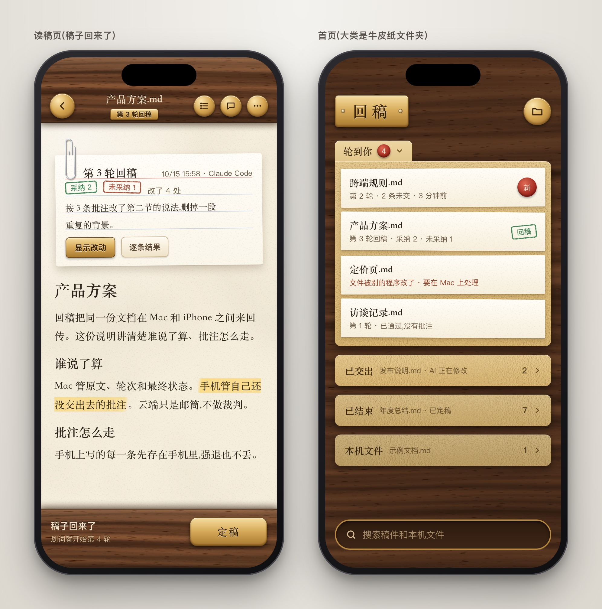
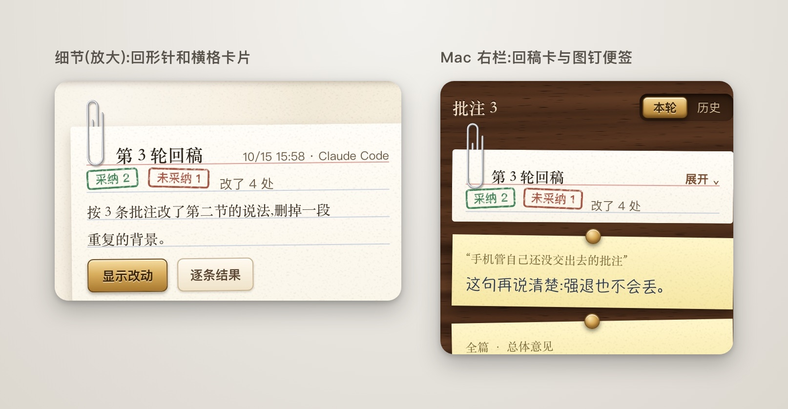
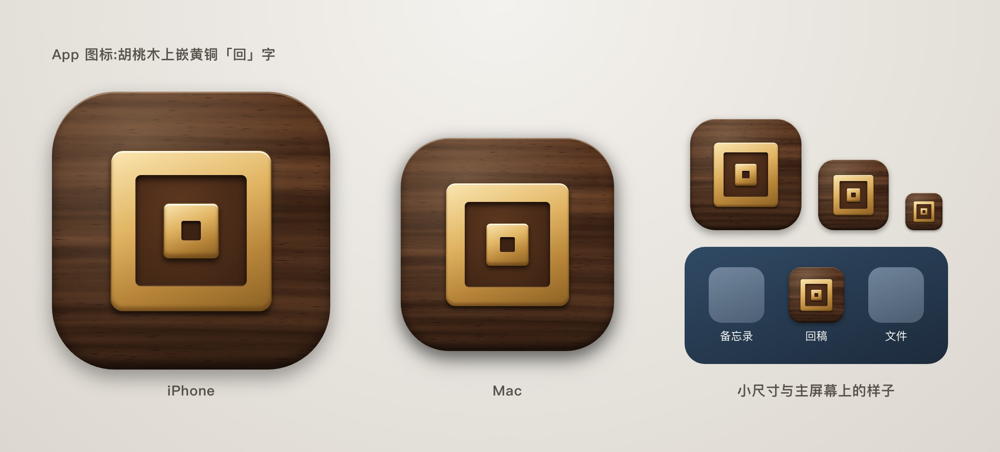

# 回稿拟物界面方案

第二版,10 月 16 日。按你的意见改了:

- 去掉方案 B。只留 A 和 C。
- 所有材质去掉竖条纹,改成细颗粒。
- A 的回形针重画了。横格卡片上的字落在线上。
- C 改年轻了。深棕红皮和金字去掉,换成雾蓝软皮、纸胶带和贴纸。

每套四张图:手机读稿页和首页、细节放大、Mac 窗口、App 图标。

看完请直接在这篇上批注:选哪一套、哪里还要改。写好后点「交给 AI」。

## 这一版具体改了什么

- **竖条纹:** 上一版的木纹、金属纹、纸纹,是用一排重复的细线画的,所以像条纹布。这一版都换成细颗粒。纸只有很淡的纤维点。木纹顺着木条横着走,粗细不一,不重复。皮面是细小的颗粒。
- **回形针:** 现在是一根有高光、有阴影的钢丝。外圈压在卡片正面,内圈夹在卡片背面。卡片上沿以上,能看到两圈套在一起。
- **横格卡片:** 标题写在红线上,每行字写在一条蓝线上。「采纳」「未采纳」是盖上去的章,可以压到线。
- **方案 C:** 深棕红皮、烫金字、红页边线、丝带书签都去掉了。改成雾蓝软皮、白色丝印字、象牙白纸、彩色纸胶带、圆形贴纸、浅色荧光笔。「定稿」还是火漆印,印面改成「回」字的两个方框。

## 两套都一样的地方

- **正文像真纸。** 纸有颜色、细纤维和阴影,正文用宋体。
- **读的时候整屏是纸。** 上下栏收起,不留黑边。这一条已经在手机构建 8 里做了。
- **Mac 和手机用同一套材质。** 深色模式另做一版「夜读」:纸变暗,木头或皮面保留。
- **App 图标也是同一套材质。** 图标上的「回」字是两个套在一起的方框。

## 方案 A · 纸与胡桃木

- **感觉:** 温暖、沉稳,像在书房的木桌上看稿。
- **材质:** 上下栏是胡桃木条,按钮是黄铜。首页的大类是牛皮纸文件夹,稿件是夹在里面的纸条。回稿卡是回形针别着的横格索引卡。Mac 上的批注是图钉钉住的黄色便签。
- **好处:** 和「在纸上读稿、批注」最贴。深色木框把视线收在纸上,晚上看也不刺眼。
- **代价:** 整体颜色偏深、偏重。

## 方案 C · 软皮手账

- **感觉:** 年轻、清爽,像自己天天带着的手账本。
- **材质:** 上下栏是雾蓝软皮,字是白色丝印。纸是象牙白。回稿卡和便签用彩色纸胶带贴着。采纳、未采纳是圆形贴纸。批注是浅色荧光笔加手写字。首页的大类是手账分隔页,右边露出彩色标签。「定稿」是一枚红色火漆印,按下去就是「盖章定稿」。
- **好处:** 最有记忆点,定稿最有仪式感。皮面颜色可以换:雾蓝、鼠尾草绿、燕麦,见图标那张图。
- **代价:** 元素最多,做起来工作量最大。手写字体在手机小屏上的可读性要实测。

## 我的建议

我倾向 **方案 C**。

- 浅色、年轻,不显老气。
- 火漆印、纸胶带、贴纸,都对应回稿里真实的动作:盖章定稿、贴上回稿卡、标出采纳。
- 皮面颜色以后可以做成设置,让用户自己选。

如果你更喜欢 A 的沉稳,A 也可以借用 C 的火漆印做「定稿」。

## 选定以后的步骤

1. 我把选定的方案画全:所有页面(批注输入框、设置、提示框)、深色夜读版,以及图标的最终版本。画完再给你看一次。
2. 你确认后,我先改 Mac,再改手机。改完照常先测试,再装机。
