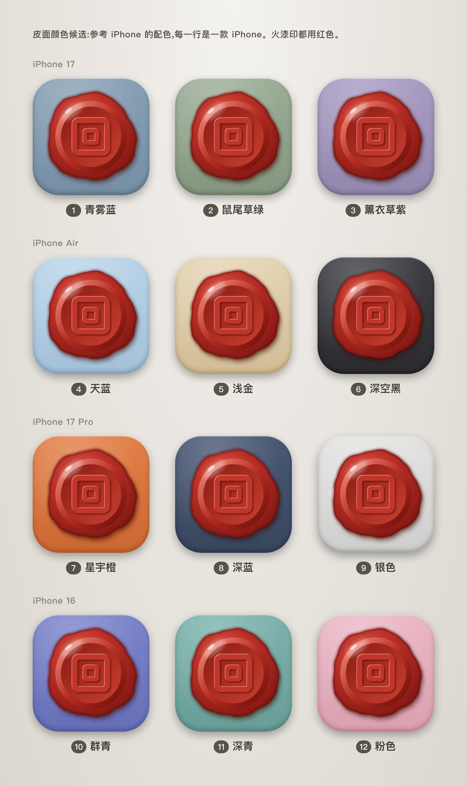
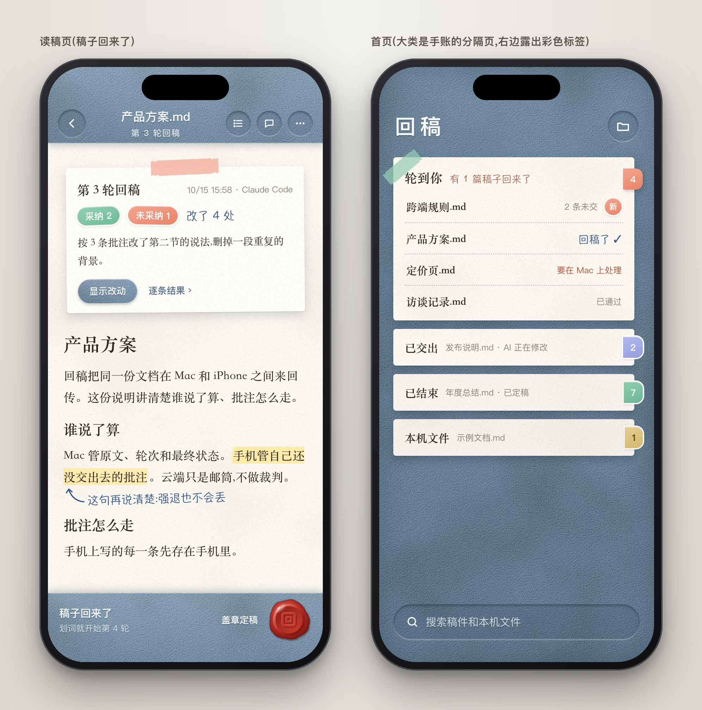
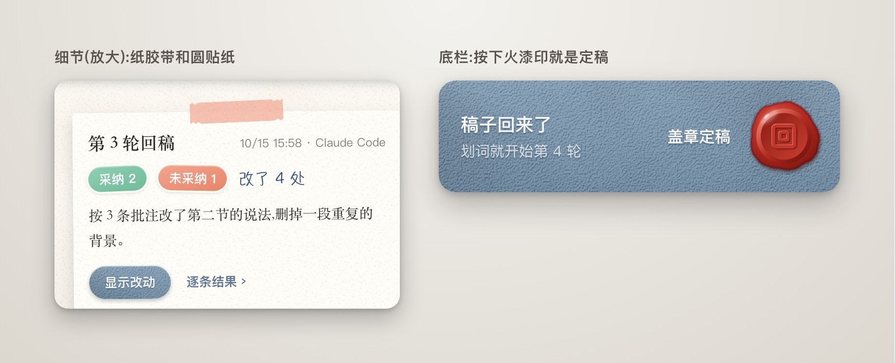

# 回稿拟物界面方案

第三版,10 月 16 日。你选了方案 C(软皮手账)。这一版做了三件事:

- 图标上的火漆印放大了。
- 皮面颜色参考 iPhone 的配色,做了 12 种候选。
- 方案 A 拿掉了。

看完请在这篇上批注:留哪几种颜色、默认用哪一种。写好后点「交给 AI」。

## 图标:火漆印放大

- 原来火漆印只占图标宽度的一半多一点。现在占八成多,四周还留一圈皮面。
- 印面「回」字的两个方框也放大了。图标缩到最小,也能看出是一枚印章。

## 皮面颜色:12 种候选

- 每一行是一款 iPhone 的配色:iPhone 17、iPhone Air、iPhone 17 Pro、iPhone 16。颜色名字用苹果官网的叫法。
- 颜色照着 iPhone 调,但做成了皮面:稍微柔和一些,带细颗粒。
- 浅色的皮面(天蓝、浅金、银色、粉色)上,字改成深色,不然看不清。
- 火漆印都用红色。在每一种皮面上都看得清楚。
- 今年 iPhone 18 Pro 的酒红色没有放进来。这种皮面会和红色火漆印混在一起,也接近你说老气的深红皮。

## 主题:给用户自己选

对,做成设置里的一项,叫「封面颜色」。

- 选一种颜色,上下栏、首页的皮面和按钮一起换。纸的颜色不变。
- iPhone 上的 App 图标也可以跟着换。换的时候系统会弹出一句提示。这是苹果的规定,去不掉。
- Mac 上只有程序坞里的图标能跟着换。
- Mac 和手机各选各的。
- 深色模式的「夜读」版另做。每一种皮面颜色都能配夜读。

## 请你决定

1. **留哪几种颜色。** 太多反而难选。我建议留 6 种:1 青雾蓝、2 鼠尾草绿、3 薰衣草紫、5 浅金、6 深空黑、7 星宇橙。
2. **默认用哪一种。** 我建议 1 青雾蓝。它就是第二版用的颜色,也是 iPhone 17 的颜色。

直接写编号就行,比如「留 1、2、4、6,默认 2」。

## 方案 C 全貌(第二版的图)

- **感觉:** 年轻、清爽,像自己天天带着的手账本。
- **材质:** 上下栏是软皮,字是丝印。纸是象牙白。回稿卡和便签用彩色纸胶带贴着。采纳、未采纳是圆形贴纸。批注是浅色荧光笔加手写字。首页的大类是手账分隔页,右边露出彩色标签。「定稿」是一枚红色火漆印,按下去就是「盖章定稿」。
- **代价:** 元素最多,做起来工作量最大。手写字体在手机小屏上的可读性要实测。

## 选定以后的步骤

1. 按你定的颜色,把所有页面画全:批注输入框、设置(含「封面颜色」)、提示框、深色夜读版,以及图标的最终版本。画完再给你看一次。
2. 你确认后,我先改 Mac,再改手机。改完照常先测试,再装机。
