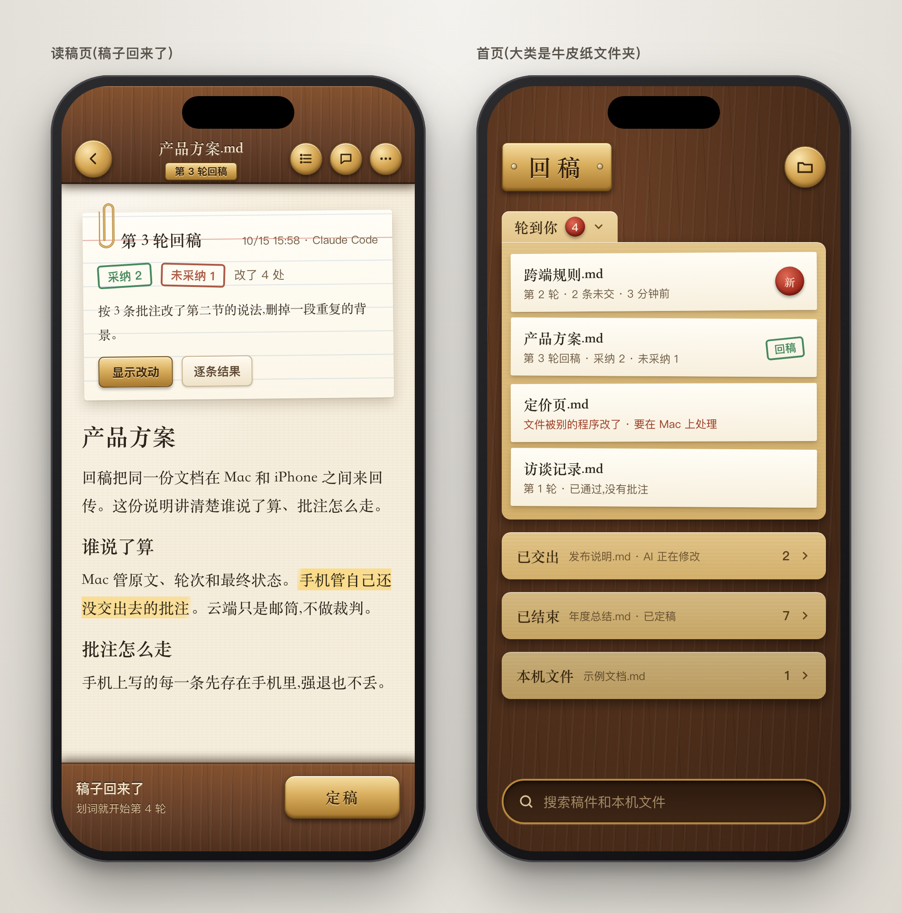
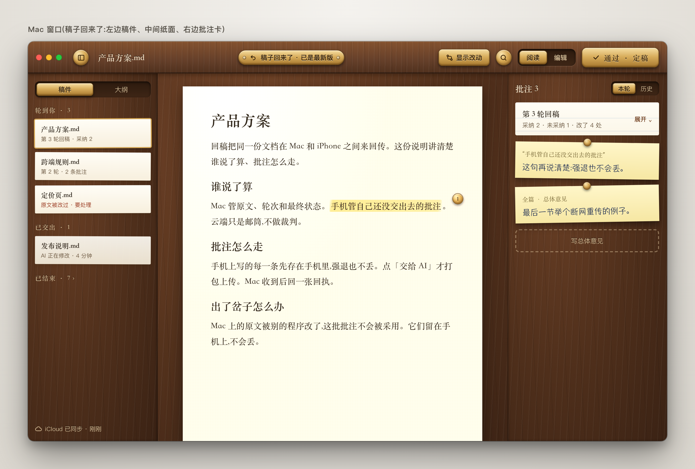
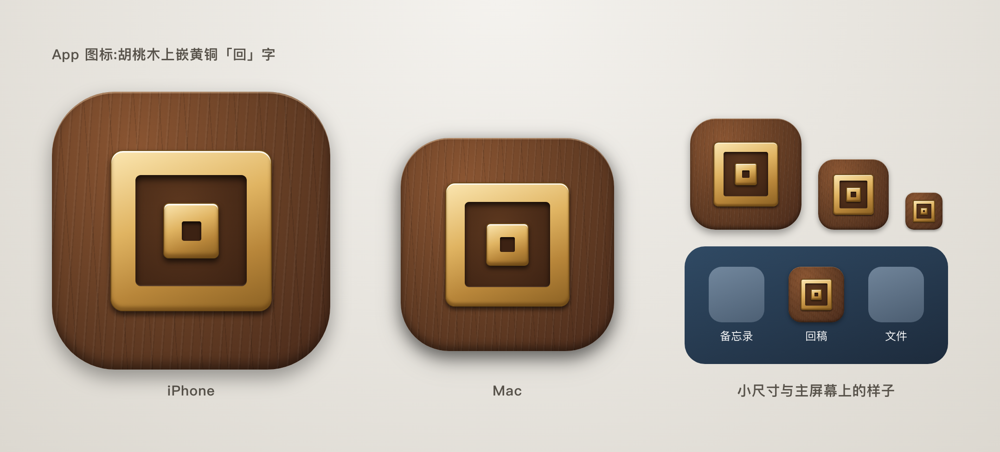
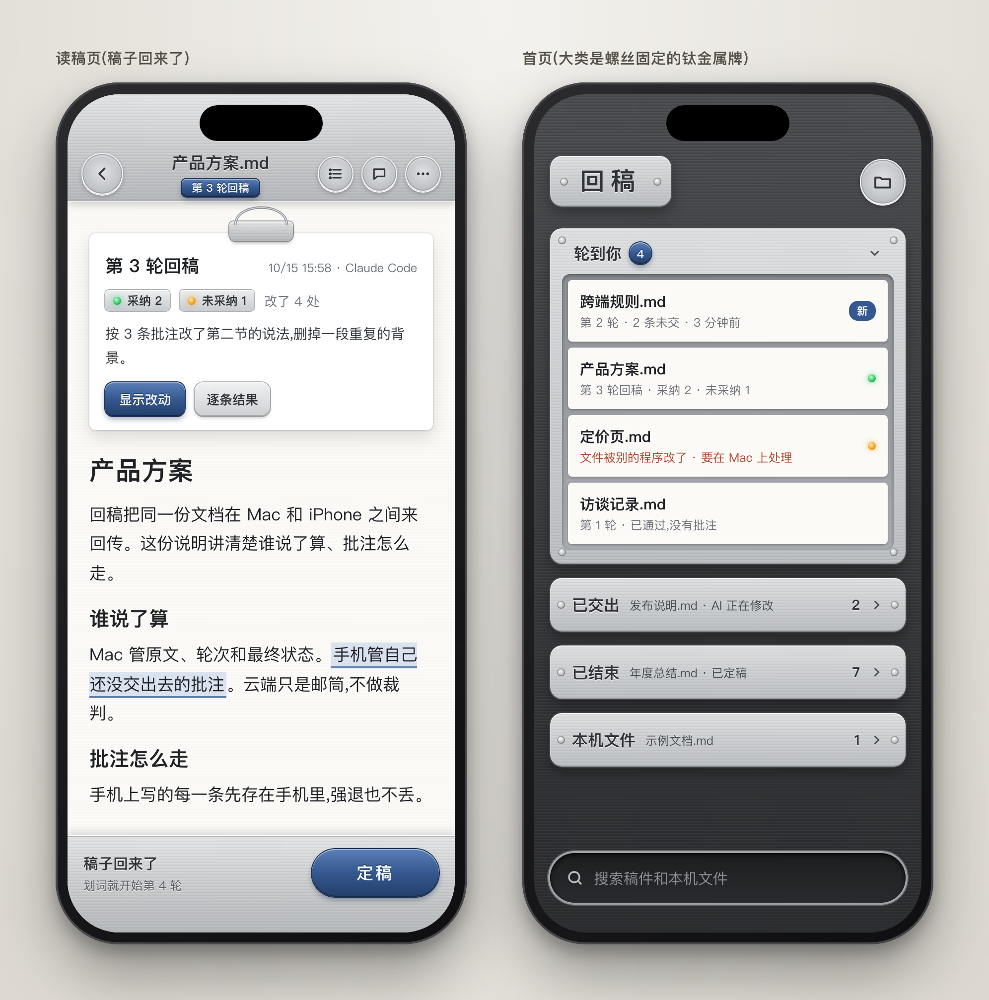
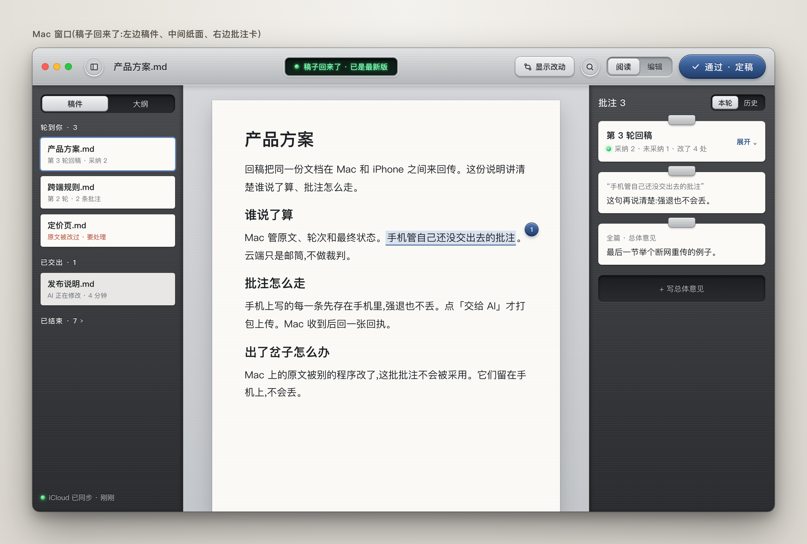
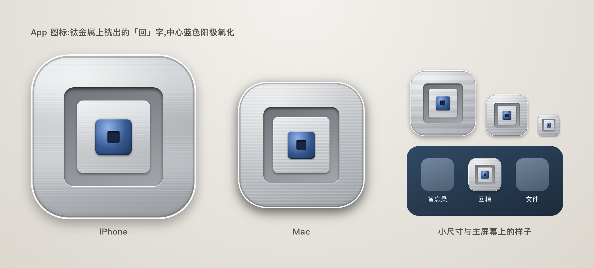
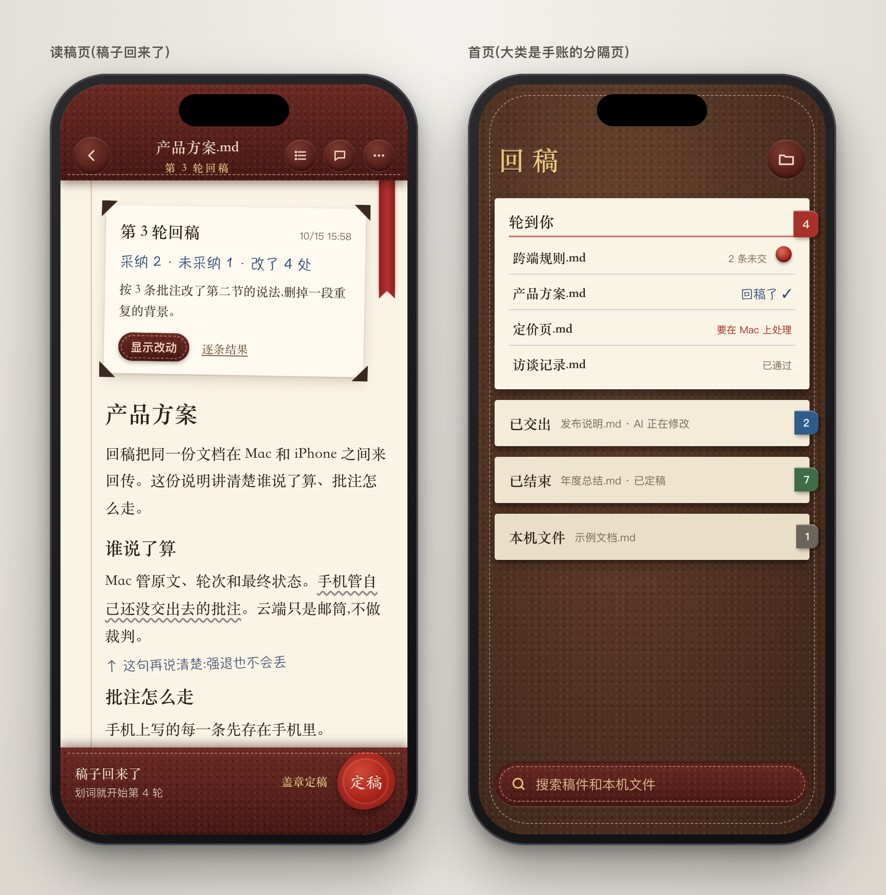
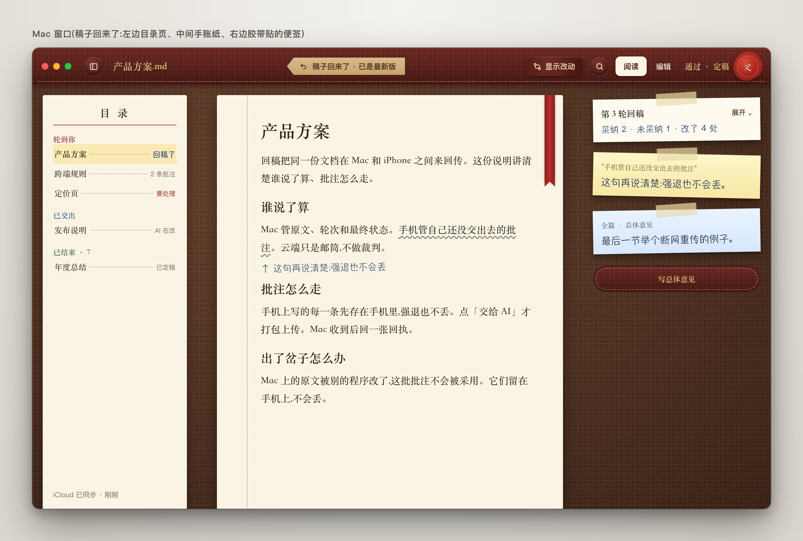
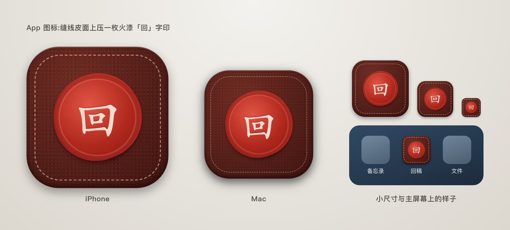

# 回稿拟物界面方案

三套方案,每套四张图:手机读稿页、手机首页、Mac 窗口、App 图标。图里的文字和稿件都是回稿里真实的内容。

看完请直接在这篇上批注:选哪一套、哪里要改、要不要混搭。批注写好交给 AI,我按批注改图,再交回给你。

## 三套都一样的地方

- **正文像真纸。** 纸有颜色、纹理和阴影,正文用宋体。
- **读的时候整屏是纸。** 上下栏收起,不留黑边。这一条已经在手机构建 8 里做了。
- **东西都是实物。** 回稿卡像别在纸上的卡片;采纳、未采纳像盖的章或亮的灯;批注像荧光笔或铅笔画的;「定稿」是一个看得见、按得下去的实物按钮。
- **Mac 和手机用同一套材质。** 深色模式另做一版「夜读」:纸变暗,木头、金属、皮面保留。
- **App 图标也是同一套材质。** 「回」字是两个套在一起的方框,图标就用这个形状。

## 方案 A · 纸与胡桃木

- **感觉:** 温暖,像在书房的木桌上看稿。
- **材质:** 上下栏是胡桃木条,按钮是黄铜;首页的大类是牛皮纸文件夹,稿件是夹在里面的纸条;回稿卡是用回形针别着的索引卡;Mac 上的批注是用图钉钉住的黄色便签。
- **好处:** 和「在纸上读稿、批注」最贴;暖色不抢纸的戏,晚上看也不刺眼。
- **代价:** 整体颜色偏深、偏重;木纹在手机小屏上比较显眼。

## 方案 B · 纸与钛金属

- **感觉:** 精密、现代,像 iPhone 的钛金属边框。
- **材质:** 上下栏是拉丝钛金属,边缘有高光倒角;按钮是机加工的圆钮;状态用绿灯、黄灯表示;主按钮是蓝色阳极氧化钛;首页的大类是四角带螺丝的金属牌;Mac 中间用浅灰毛毡衬着纸;Mac 顶部的状态显示像仪器上的小屏幕。
- **好处:** 和苹果设备的外观最搭;状态一眼看得清。
- **代价:** 偏冷,纸面以外缺少温度。

## 方案 C · 皮面手账

- **感觉:** 私人手账,有人情味。
- **材质:** 上下栏是缝线皮面;纸上有红色页边线和丝带书签;批注是铅笔波浪线加手写字;便签用胶带贴;首页的大类是手账的分隔页,右边露出彩色标签;「定稿」是一枚红色火漆印,按下去就是「盖章定稿」。
- **好处:** 最有记忆点;定稿的仪式感最强。
- **代价:** 元素最多,做起来工作量最大;手写字体在手机小屏上的可读性要实测。

## 我的建议

推荐 **方案 A 为主,借用方案 C 的火漆印做「定稿」**。

- 胡桃木和黄铜的暖色,最衬「在纸上读稿」。
- 书房的木桌上盖一枚火漆章,风格不冲突,定稿也有仪式感。
- 方案 B 的指示灯不建议混进来:金属仪器和木头书房混在一起会乱。

## 选定以后的步骤

1. 我把选定的方案画全:所有页面(批注输入框、设置、提示框)、深色夜读版,以及图标的最终版本。画完再给你看一次。
2. 你确认后,我先改 Mac,再改手机。改完照常先测试,再装机。
