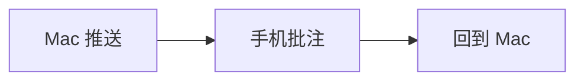

# MDTurn 手机端示例

这是一篇随 App 自带的示例文档,用来验证**手机上的阅读与划词批注**。长按任意一段文字,拖动选区,在弹出的菜单里点「批注」。

## 为什么要在手机上批注

- 路上读、路上批,回到 Mac 智能体接着改。
- 批注的锚点格式与 Mac 完全一致,整批回传不丢信息。
- 每条批注先存在手机本地,强退也不丢。

## 表格与代码

| 环节 | 状态 |
|---|---|
| 阅读 | 可用 |
| 批注 | 可用 |
| 同步 | 等开发者账户 |

```swift
let note = Note.make(anchor: anchor, quote: quote, comment: "改一下", scope: nil)
```

公式 $E = mc^2$ 与图表:



> 引用块里的文字同样可以批注。

### 第三级标题

最后一段:完成批注后,点右上角菜单里的「完成本轮:导出批注批次」,把批次文件隔空投送到 Mac。
